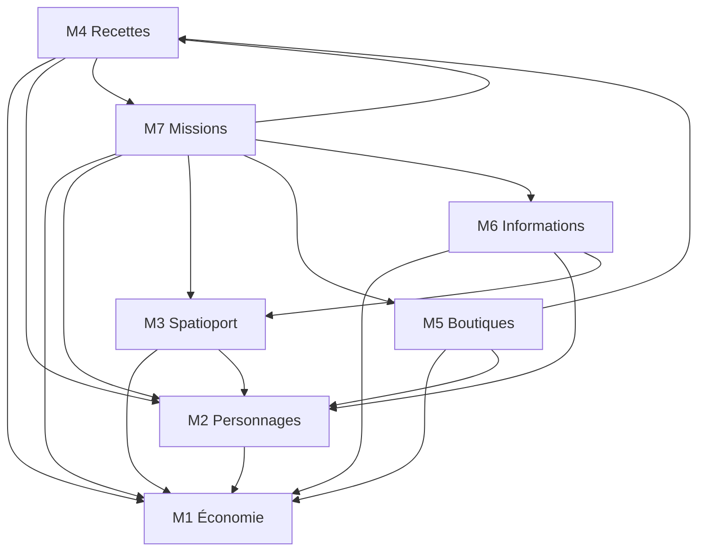

# SO-00 V3.4 — audit différentiel et plan du Master central

23 octobre 2026. **Plan soumis à validation ; aucune migration ni implémentation V3.4 effectuée.** Cette tranche ajoute uniquement le dossier d’audit, les sources et un script de sondes sur données fictives en mémoire. Elle conserve L1a–L1m, SO-06a, SO-01a et SO-06b. Le produit complet n’est pas conforme au cahier V3.4 et n’est pas prêt pour un GN.

La demande explicite de reprise impose : « Attendre validation de ce plan avant opérations de migration. » Les choix techniques ci-dessous sont des **propositions**, distinctes des décisions produit et des règles canoniques déjà validées. Aucun nouvel arbitrage de jeu n’est demandé.

## 1. Sources et état vérifié

| Source lue | Identification et portée |
|---|---|
| [SO_CDC_V34.md](source/SO_CDC_V34.md) | Copie exacte de SO_CDC_V34(1).md, 754 lignes, SHA-256 `c133f5a8fb351ab7cbf30ca34e323b852491d5b5df6ce75d04687a9667794421`. Lecture intégrale ; §3, §10 et 10 MST gouvernent la présente conception. |
| SO_Regles_V07(1).docx | SHA-256 `7f9cb723e5395d643dffa636a626498fe01d1b1f3a8c421a88a60c2725b1fd73`, identique au livre intégralement lu pour SO-01a/SO-06b. [Transcription conservée](source/SO_Regles_V07.txt). A01–A38 et FOR-01 restent clos. |
| SO_Masters_V01.zip | SHA-256 `8af50e64b0363d1b4fc9bc1278be44389b55d57bd91957df80ced55c97f8e9be`. Sept XLSX, 56 feuilles dont 42 métier/références ; **zéro ligne métier renseignée**. [Rapprochement détaillé](SO-00-V34-GABARITS.md), [extraction complète](source/SO_Masters_V01.audit.json). |
| SO_Vademecum(1).docx | SHA-256 `4b134d69b4348b3da8e8adbd4de88811c4f5c27b2f708359fbb6881a1b3d24fc`. Corps, tableaux, en-tête et pied lus ; aucune image intégrée. [Transcription](source/SO_Vademecum_V01.txt). |
| Documents/code existants | README, MASTERS, ESPACES-JOUEUR, LOGISTIQUE, CAMPAGNES, ACTIONS-TERRAIN, MEDIATHEQUE, rapports SO, schémas/importeurs, permissions, versions, campagnes, archives, tests correspondants. Les descriptions historiques « restant à faire » ne remplacent pas le code courant. |

Le cahier garde des reliquats éditoriaux : introduction « rapport de cohérence V0.7 » contre annexe C citant V0.6, annexe A.1 « version 0.6 » malgré profil V0.7, §8.3 « chaque Master » et validations locales. Application de la hiérarchie explicite : V0.7 pour le jeu, **§3 V3.4 pour une publication globale** ; les historiques d’ateliers sont des historiques d’import, jamais sept autorités. Le rapport V0.6 reste historique. Aucun nouveau barème de recette/prix n’est déduit des gabarits vierges.

### Références GitHub au début de l’audit

| Élément | État observé |
|---|---|
| `main` | [`03eaace155b052d1b7d1960347746e9ee60ed514`](https://github.com/gkerckhofs-a11y/gn-engine/commit/03eaace155b052d1b7d1960347746e9ee60ed514), package **0.36.0** ; [CI 39746169456](https://github.com/gkerckhofs-a11y/gn-engine/actions/runs/39746169456) réussie, fin 22 octobre 08:29:24 UTC. |
| Branche retenue | `work/l1-modular-workshop`, [`80c3a9cbce56d4dd7661c1b57f2fb01b348a9888`](https://github.com/gkerckhofs-a11y/gn-engine/commit/80c3a9cbce56d4dd7661c1b57f2fb01b348a9888), package **0.37.0**. [PR #1](https://github.com/gkerckhofs-a11y/gn-engine/pull/1) ouverte en brouillon, non fusionnée. Préserve toutes les tranches dépendantes. |
| Checkout local | Commit `57cabe03f55d3dd50bcd7ac89eea09c2f6d4adc6`, arbre **identique** au distant : `fcabd8683da865759268558821e8f162e11ad5a5`. SHA de commit local différent, arbre comparé explicitement. Propre avant ajout des documents d’audit. |
| Autres branches | `codex/mission-participation-0.18` à `7072cda44252d2fded85bfe9661240140eed0a61` ; `codex/open-bounties-0.17` à `787ffbdc3d17b768a0bb44aab6a4d1bb015a871a`. Conservées, aucune fusion ni suppression. |
| Tags | Requête Git `matching-refs/tags/` : liste vide. |
| CI de la base candidate | [Push 39953481233](https://github.com/gkerckhofs-a11y/gn-engine/actions/runs/39953481233) et [PR 39953486474](https://github.com/gkerckhofs-a11y/gn-engine/actions/runs/39953486474) : succès, **793 applicatifs + 611 Firebase chacun**, build compris. Node 22.23.3 / Java 21.0.12+1. La PR a testé la fusion virtuelle `38156a3a8722b71fb77f2a9c02a272187a450e0d`, pas une fusion réelle. Résultats SO-06b, pas tests de la future architecture. |
| Artefacts | API du run push ci-dessus : aucun artefact attaché. Logs GitHub et journaux versionnés constituent les preuves disponibles ; pas d’archive de sauvegarde certifiée. |
| Dernier déploiement trouvé dans les runs récents | [39731774273](https://github.com/gkerckhofs-a11y/gn-engine/actions/runs/39731774273), SHA `d5334d8dfcb493421c9bd4efaf83c50eb56e373f`, succès le 22 octobre 06:24:29 UTC. Métadonnées relues ; site réel, comptes et données de production non inspectés pour cette reprise. |

`check.yml` déclenche build/tests/émulateurs sur push/PR, projet `demo-gn-engine`, sans étape de déploiement. `deploy-firebase.yml` exige un déclenchement manuel ou un changement du marqueur sur **main** ; aucun n’a été demandé. `verify-live.yml` n’a pas été lancé. Le commit documentaire et ses résultats CI exacts seront consignés dans la PR après leur exécution, conformément à AGENTS.md.

## 2. Diagnostic du socle réutilisable

Le modèle existant distingue déjà **scénario éditable → version de scénario figée → session indépendante → épisode de campagne conservant les acquis**. Il ne faut pas remplacer ce socle.

- `src/core/masters.mjs` construit un état projeté, contrôle des références, affiche un diff, confirme par empreinte et applique le lot transactionnellement. `masterRows`, `masterImports`, `masterHistory` et `operations` assurent provenance partielle, versions de lignes et idempotence. L’édition web utilise le même circuit.
- Le scénario éditable peut servir de préparation, mais il n’existe pas de **brouillon Vn+1 identifié par campagne**, ni de pointeur central publié de campagne avec conflit de parent. Une référence absente bloque dès l’import, même si l’auteur souhaite la compléter dans un autre fichier plus tard.
- `publishScenario` copie les collections existantes en une transaction et conserve les anciennes versions. Il ne fait pas avancer la révision du scénario, ne possède pas de comparaison atomique du parent de campagne et ne déduplique pas deux demandes distinctes de publication de contenu identique. La sonde mémoire a produit **deux snapshots distincts pour la même révision**. Ce n’est pas une observation de version hybride ; c’est un écart avec la future règle de publication unique/concurrente.
- `cleanScenarioSnapshot` possède déjà une validation de graphe, mais le chemin `publishScenario` applique une liste différente de validations. Les règles doivent converger vers un seul validateur central ; les vérifications locales d’import restent utiles.
- `session-seed` crée des instances : portefeuilles, lots et réserves de lieu. L’import historique **SESSION** peut aussi initialiser un nouveau personnage, des connaissances, une réserve de fouille et une navigation. Il serait faux de dire que tous les imports actuels sont sans effets d’initialisation.
- `campaigns` sait sceller, copier par pages et rendre une nouvelle session visible seulement après copie complète. Ce mécanisme est réutilisable pour préparer une version volumineuse. L’épisode suivant reprend actuellement la configuration de l’épisode précédent ; il ne sélectionne pas une nouvelle version centrale en fusionnant explicitement configuration et acquis.
- Comptes, lots, paiements, transactions, actions, QR et médias restent dans leurs services. Le `PUBLISHED` d’une fiche historique est un état de visibilité de contenu, pas le pointeur de publication globale V3.4.

## 3. Matrice V3.4 / existant / adaptation / création / preuve / migration

Tous les chemins ci-dessous sont audités sur la branche `work/l1-modular-workshop` à `80c3a9c`. Les tests nommés sont des preuves **partielles existantes**, jamais une certification MST.

| Exigence | Existant | À adapter | Nouveau nécessaire | Preuve et lot | Risque / migration proposée |
|---|---|---|---|---|---|
| Six domaines, sept ateliers | `workshop-modules`, éditeurs L1 | Séparer navigation et propriété des collections : Objets devient M1, Recettes M4 secondaire | Entrées M1–M7 et accueil Publication | Tests UI/modules ; SO-00/01 | Garder identifiants de routes UI et format 1 historiques ; aucun déplacement de documents métier |
| Un brouillon par campagne/base | Scénario éditable, versions | Contexte et isolation par campagne | En-tête de brouillon, changements versionnés, base publiée | MST-02/07 ; première tranche centrale | Ne pas utiliser le scénario mutable partagé par plusieurs campagnes comme brouillon implicite |
| Imports web/XLSX communs | `prepare/applyMasterImport`, projections | Extraire planification sans effets d’instance | Adaptateur brouillon et métadonnées V3.4 | Suites Masters, MST-01/02 | Contrat v1 inchangé ; nouveau chemin explicite, opt-in |
| Références encore incomplètes | Maps projetées d’un seul lot | Stocker structure valide, diagnostiquer liens non résolus | Provenance de champ et statut bloquant | MST-04/05 ; sonde refus actuelle | Ne pas affaiblir validation des imports historiques/session |
| Catalogue unique et propriétaires | `items`, `skills`, `characters`, etc. | Projections/sélecteurs sur base + changements | Registre atelier→type/chemin | MST-03/08 | Pas de catalogue ingrédients/produits dans M4/M5 |
| Diff global | Diff par import, `master-dependencies` informatif | Graphe complet, erreurs localisées, impact secrets/QR | Rapport global lié à révision/empreinte | MST-05/08/09 | Une erreur ne doit pas masquer les autres ; ligne/colonne conservées |
| Publication atomique logique | Snapshots scénario, transactions, `campaignBuilds` | Validation commune, lecture des seules versions prêtes | Préparation immuable + bascule atomique du pointeur | MST-04/07/09 | Aucune session ou partie de version exposée pendant la copie |
| Double clic / deux MJ | `operations`, empreinte, révisions | ID global de publication et contrôle de parent | Reçu de publication unique, conflit explicite | MST-07 ; émulateurs requis | Révocation/droit revérifiés avant réessai et bascule |
| MJ habilité | Google vérifié ; propriétaire ; `sessionStaff` | Étendre le service de permissions au périmètre campagne | Grants explicites édition/publication | Tests OWNER/MJ/RECEPTION/joueur, révocation | Aucune délégation de session promue automatiquement ; aucun droit IAM/Firestore client modifié |
| Définitions ≠ argent/stock | `items` vs `inventory`, comptes/ledger | Exclure seeds du chemin central | Propositions de dotation + commande séparée | MST-06 ; suites dotations existantes | Préserver le comportement v1 dans le contexte historique ; V3.4 n’utilise pas son apply SESSION |
| M1 Économie | Objets, Cours, Tarifs, entrepôts | Champs SO, 12 prix canoniques et restrictions | Profils équipements/modules fermés | SO-01/05 ; MST-03 | Pas de changement des lots acquis ou prix de contrats |
| M2 Personnages | L1c/e/h/i, natures SO-01a, PA/soins | Profil SO fermé et propositions d’attributions | XP/relève, kits/200 Cr protégés, Force secrète | SO-01/02, REC-01…05/FOR | Ni nature ni acquis historiques réécrits ; FOR non assignable par cellule de rôle |
| M3 Spatioport | Ships, routes, voyages/cargo, L1d | Distinguer modèle/instance et appliquer aux futurs départs | Modèles, ports typés, passagers, combat, incidents, atelier | SO-04 ; MST-09 | IDs/QR permanents, carburant/état/contrats figés conservés |
| M4 Recettes | SO-06b `recipes` DRAFT, composants `items` | Sélecteurs centraux, composition/version/provenance | Registre d’effets autorisés, labos, déblocages, TOXI/doses | SO-02/05, REC-01…05 ; MST-04/07 | Publication jouable actuellement interdite ; ne pas contourner ce verrou pour une démonstration |
| M5 Boutiques | `market`, `sales`, comptes, lots | Ventes depuis vrais stocks et caisses | Définitions boutique/offre et droits vendeur | SO-05 ; MST-03/06/08 | Une offre n’est pas un lot ni une création de caisse/monnaie |
| M6 Informations | Knowledge/reçus, fieldTargets, actions, L1f/g | Conditions SO et liens typés | Configurations manquantes de découverte | SO-06 ; MST-05/08 | Pas de redistribution de reçus ni de nouvelle réserve à l’import |
| M7 Missions | Objectifs, annonces, contrats/primes, finance | Modèles préparatoires distincts des contrats signés | Étapes/RDV/conditions/déclencheurs SO restreints | SO-06/05 ; MST-05/08 | Aucun XP, paiement ou déblocage lancé à la publication ; supprimer financement externe du parcours SO, pas de l’histoire |
| Effets et QR | Actions terrain/personne, projections privées | Profil/règles versionnés et capacités du serveur | Effets canoniques manquants et migrations explicites | SO-02/03/04/05 | QR d’interaction jamais invitation privée ; aucune Force cachée dans exports joueurs |
| Épisodes futurs | Session versionId, sceau, copie par pages | Sélection de config cible + bilan d’impact des acquis | Plan de reprise mixant config validée et instances conservées | SO-06 ; MST-10, REC-23 | A38 encore incomplet : voyages/contrats ouverts bloqués, option RESTORE historique ; aucune guérison dans chemin SO |
| Archives / rollback | `.gnscenario.zip`, copie isolée, hashes médias | Manifeste de version avec graphe, provenance et imports | Retour de config par nouvelle activation auditée | MST-10 ; suites archive/campagne | Pas de rollback de ledger ni restauration aveugle de la base après jeu |
| Compatibilité CAMPAGNE/SESSION | Quatre XLSX v1, tests fichiers et campagnes | Adaptateur v1→brouillon sans seeds | Aperçu de conversion volontaire | MST-01 | Aucun remplacement silencieux du format 1 ni remise à zéro de sessions |
| Mobile/réseau/charge | Responsive, contrôleurs testés, requestId | État certain/incertain et reprise de publication | Recette appareils et charge mesurée | G5, SEC-09 | Aucun essai humain/mobile/60 utilisateurs réalisé ici |

Les écarts de jeu A01–A38/FOR-01 recensés dans la [matrice métier](MATRICE-SPACE-OUTLAWS-V3.md) restent ouverts. La V3.4 change leur ordre et leur publication, pas leurs règles.

## 4. Graphe des dépendances à contrôler

Les flèches représentent **« référence »**, pas un ordre obligatoire d’import/publication. Les types de liens, permissions et visibilité doivent être vérifiés, pas uniquement l’existence d’un ID.

M4→M7 exprime la source d’un déblocage ; M7→M4 une récompense/découverte de formule. Cette relation circulaire de préparation est autorisée si les deux définitions existent et si elle ne constitue pas un cycle d’exécution impossible. Résoudre les identités avant les liens ; aucune obligation de publier M1, puis M4, puis M5. Les lieux/QR existants et médias sont des références communes, **pas un huitième catalogue**. Le graphe conserve aussi les arêtes internes : classe→compétence, relation→personnage, fouille→installation, profil→consommable, recette→produit/composants, offre→objet/caisse, événement→route, tarif→bénéficiaire.

## 5. Architecture minimale proposée — à valider

### Données et services

1. Garder `scenarios/{id}`, `scenarios/{id}/versions/{versionId}`, `campaigns/{id}`, `sessions/{id}` et leurs collections. Le modèle source historique reste disponible ; la campagne choisit une référence de version précise. Le nouveau parcours de préparation doit pouvoir créer un conteneur de campagne **sans créer son premier épisode ni ses dotations** ; aujourd’hui `startCampaign` fait les deux. Cette séparation sera additive et explicite.
2. Ajouter à une campagne ayant volontairement adopté V3.4 un petit en-tête `master` : version de contrat, scénario, `activeVersionId`, révision monotone du pointeur et `openDraftId`. Une ancienne campagne sans ce champ reste dans son parcours historique. Plusieurs campagnes peuvent partir du même snapshot, mais ne partagent jamais leurs changements de brouillon.
3. Proposition de stockage : `campaigns/{campaignId}/masterDrafts/{draftId}` avec `baseVersionId`, `basePointerRevision`, `revision`, `ruleProfile`, `status`, auteur/dates ; sous-collections de **changements**, imports et contrôles. Un changement est indexé par type métier + ID durable, et contient opération, champs préparés, révision attendue et provenance. Ce sont des versions préparatoires, pas un catalogue parallèle exploité par le jeu.
4. La projection du brouillon combine **snapshot de base + changements**. Les sept ateliers lisent cette projection filtrée par droit. Chaque type est écrit par son atelier propriétaire. Les IDs sont attribués de façon stable dès la création ; le premier lot n’a pas besoin d’IDs temporaires. Si des alias locaux sont ajoutés ensuite, ils restent limités au brouillon et doivent être résolus avant publication.
5. Réutiliser les nettoyeurs métier, le lecteur XLSX strict, les projections et sérialisations L1. Extraire la planification de `masters` afin de choisir un réceptacle de préparation sans appeler `seedWallets`, `seedInventory`, `seedKnowledge`, `seedFieldTargets` ou `seedShip`. Les effets d’initialisation restent des commandes séparées.
6. Distinguer validation **structurelle** (type, taille, ID, champ autorisé, atelier, absence de code/formule) à chaque enregistrement et validation **globale** (références, droits, publication voulue, profil, économie, compatibilité) avant publication. Une référence manquante structurellement valide est enregistrable dans le brouillon, avec erreur bloquante et provenance, sans visibilité joueur.
7. Conserver `publicationState` pour le sens historique de visibilité ; ne pas le confondre avec l’état du brouillon central. Une version complète peut conserver des contenus explicitement inactifs, mais aucune référence active ne pointe sur un contenu inactif et aucun bloquant n’est ignoré. Un effet non implémenté reste inactif. Une recette ne sera déclarée activée qu’après la livraison de son registre, labo, déblocage et moteur TOXI.
8. Étendre les permissions serveur existantes par grants de **campagne** (édition d’ateliers, consultation globale sensible, contrôle/publication). Stockage proposé sous la campagne, en reprenant identité/normalisation/révocation des services `staff`. Ce sont de nouvelles autorisations de périmètre, pas une copie automatique des grants `sessionStaff`. OWNER peut déléguer ; MJ sans grant, Accueil et joueur sont refusés. Une valeur XLSX ne peut pas créer un grant. La publication exige accès au rapport global complet.

### Transaction de publication et absence de version hybride

1. Le serveur lit une révision précise du pointeur et du brouillon, matérialise la configuration cible et produit le diff/graphe/diagnostics. Chaque diagnostic conserve atelier, fichier/édition web, batch, feuille, ligne, colonne, ID, référence et correction possible. Une erreur synthétique `References` seule ne suffit plus.
2. Il contrôle l’ensemble : références typées, états/archivages, effet autorisé dans le profil, QR public correctement ciblé, secrets non exposés, médias accessibles, quantités/unités/capacités, propositions de budget/stock et sources autorisées, compatibilité des règles et données déjà engagées. La validation de configuration n’effectue aucun mouvement économique ; les ressources seront recontrôlées transactionnellement au moment des seeds/actions.
3. Le rapport/consentement lie campagne, parent et révision du pointeur, révision du brouillon, règle/schema, empreinte de contenu, droits et ressources externes pertinentes. Toute modification invalide le contrôle. Le serveur fige la révision choisie ; les autres éditeurs reçoivent un conflit explicite ou travaillent dans la révision suivante, jamais dans le snapshot en construction.
4. Construire la version sous `scenarios/{id}/versions/{versionId}` en état interne **BUILDING**, avec manifeste/empreintes/comptages. Réutiliser le protocole de pages reprenables de campagne. Chaque page est immuable et idempotente, liée à l’empreinte figée ; elle ne relit pas un brouillon mutable. Limites explicites héritées puis mesurées : 500 fiches pour l’archive actuelle, 250 lignes/1 Mio par import, 420 écritures par lot avant indexation. Fractionner les **écritures internes**, pas la publication utilisateur.
5. Au terme, une transaction courte vérifie toutes les pages et empreintes, l’état prêt, les droits encore actifs, le parent et la révision attendus, puis marque la version **READY** et bascule `campaign.master.activeVersionId`. Elle ajoute l’événement d’activation et le reçu idempotent dans la même transaction. Aucune version BUILDING n’est listée comme disponible ni acceptée par `readScenarioVersion`, `createSession` ou un export de version publiée. Les versions historiques sans ces nouveaux champs gardent leur lecteur historique explicite.
6. Deux publications concurrentes : un seul parent/révision peut être activé. La seconde reçoit `VERSION_CONFLICT` (nom proposé) avec retour au diff/rebasage explicite, aucune fusion automatique des mêmes champs. Révision monotone pour éviter le problème « V1→V2→V1 » ; ne pas comparer uniquement l’ID parent. Même commande après perte de réponse : même version/reçu. Autre commande, même empreinte déjà active et même intention : aucun nouveau snapshot utile ni seed.
7. Une session épingle `versionId` à sa création ; chaque lecture suit cette version ou ses propres instances figées, jamais un mélange de pointeur courant et de snapshot. Une publication change la référence pour **les épisodes futurs**, sans modifier les sessions ouvertes/anciennes. Le nouvel épisode conserve les états et contrats de son prédécesseur et applique seulement les changements de configuration compatibles explicitement prévisualisés. Migration d’une session active : hors premier lot, bloquée et soumise à une autorisation distincte.

Tout point d’entrée historique susceptible de modifier la configuration doit respecter le contexte : anciens scénarios/sessions inchangés ; pour une campagne opt-in V3.4, les éditeurs de définition routent vers le brouillon. Les corrections de régie permises restent des opérations de jeu motivées, sans contourner le pointeur de configuration. Les anciennes API ne doivent pas devenir une voie de publication indirecte.

### Contrat de fichier proposé

Nouveau format versionné explicite, **sans modifier le parseur v1** : proposition `gn-engine-master-central`, version `1`, `module_type=M1…M7`. Une ligne Meta porte `scenario_id`, `campaign_id`, `rule_profile`, `central_base_version`, `draft_id`, `draft_revision`, `schema_version`, `import_batch_id`, version du pointeur de base. Le nom final du format sera figé avec les tests, pas présenté comme accepté aujourd’hui.

Les fichiers V0.1 restent des supports de rédaction. Un assistant de conversion explicite doit montrer pertes/champs non pris en charge et demander leur résolution ; jamais supprimer silencieusement des colonnes. `Ref_*` devient projection non autoritative : une modification de cette feuille ne crée ni modifie un objet M1, et doit être signalée/ignorée explicitement sans privilège. Absence de ligne = conserver ; archivage = opération explicite ; même batch/même contenu = résultat stable ; batch réutilisé avec contenu différent = refus. Les fichiers historiques peuvent être **lus et convertis vers un brouillon** avec propositions de dotations séparées, tout en conservant leur import historique dans les contextes historiques.

## 6. Démonstration cruciale et recettes MST à implémenter

Fixture synthétique avec une base publiée cohérente, PNJ/caisse/labo existants et un effet canonique effectivement implémenté. En parallèle, M1 prépare un ingrédient et son produit, M4 une formule, M5 une boutique/offre référençant le produit. Une faute volontaire dans l’ID d’ingrédient reste visible dans le brouillon ; **publier refuse la campagne entière**, aucun changement M1/M4/M5 accessible au jeu. Corriger l’ID, recontrôler, puis publier : **un seul manifeste/version/pointeur** contient les trois modifications ; zéro nouveau lot, solde, PA, XP ou dose. Un nouveau contexte de jeu autorisé voit la version complète ; les anciennes sessions restent épinglées.

Rejouer avec réponse perdue avant/après bascule, page interrompue et deux MJ concurrents. Modifier ensuite uniquement une route M3 : contrôler toutes les dépendances et produire Vn+2 sans réimport des six autres ateliers. Les empreintes des données non modifiées restent égales. Cette démonstration n’a **pas** été exécutée ici : M5, publication centrale et activation TOXI manquent. Une publication de simples brouillons inactifs SO-06b ne valide pas le critère « acceptée et activée ».

| Recette | Preuve existante réutilisable | Complément obligatoire / statut V3.4 |
|---|---|---|
| MST-01 | Quatre XLSX + exemples lus/importés par `master-files`, non-régression des campagnes | Ouverture/édition nouveau brouillon sans effet ; **NON EXÉCUTÉ** |
| MST-02 | Révision de destination/lot, historique imports | Deux fichiers même brouillon/base, origine ligne et collision ; **NON EXÉCUTÉ** |
| MST-03 | Références `items` communes à recette, profils et dotations | M2/M4/M5, propriété exclusive M1 ; **NON EXÉCUTÉ** |
| MST-04 | Objet + recette DRAFT acceptés dans un seul import historique | Deux imports/éditions du brouillon commun, une activation ; **NON EXÉCUTÉ** |
| MST-05 | Référence absente bloque le lot historique | Mission→indice absent, refus global des sept ateliers, erreur localisée ; **NON EXÉCUTÉ** |
| MST-06 | Imports recettes sans lot ; seeds historiques idempotents | Offre/stock proposé sans seed à l’import/publication, commande distincte ; **NON EXÉCUTÉ** |
| MST-07 | Révisions périmées et imports concurrents testés | Deux MJ/grants, parent concurrent, interruption copie/bascule, aucun mélange ; **NON EXÉCUTÉ** |
| MST-08 | Archivage d’ingrédient utilisé bloqué | Graphe objet/offre/mission complet et migration explicite ; **NON EXÉCUTÉ** |
| MST-09 | Export/réimport global cohérent actuel | Modification M3 seule, version complète, six ateliers identiques ; **NON EXÉCUTÉ** |
| MST-10 | Archive scénario→nouveau scénario, sessions scellées, copie reprenable | Retour de config Vn sans effacer achats/XP/stock/ledger joués ; **NON EXÉCUTÉ** |

Conserver aussi les 24 REC-SO, six FOR, cinq REC et dix SEC. REC-SO-REC-01 historique prouve l’import répété de l’exemple adapté V3.2 ; il ne prouve pas encore sa nouvelle séparation M1/M4 V3.4. Aucun succès métier complet ne découle des 793/611 tests existants.

## 7. Ordre de réalisation après validation du plan

| Tranche proposée | Raccord aux lots V3.4 et travaux conservés | Critère de sortie |
|---|---|---|
| C1 — Brouillon central et droits | SO-00→SO-01 ; L1/L1b, SO-06a, validateurs/imports | Conteneur campagne sans seed, base+pointeur, édition web M1/M2, provenance, référence différée, règles de grants, compatibilité v1 ; aucun effet d’instance |
| C2 — Publication/reprise atomiques | SO-01 + infrastructure SO-06 ; snapshots, `campaignBuilds`, archives | Contrôle global, version immutable READY, conflits, réessais, export/manifeste, restauration configuration sur données fictives ; MST-01/02/07/09/10 pertinents |
| C3 — Parcours M1/M4/M5 activable | SO-02 laboratoire + SO-05 ; SO-06b, actions, stocks/comptes/ventes | Effet canonique fermé, recettes/labo/droits et boutique/offre ; démonstration cruciale complète, sans seed implicite ; REC et MST-03/04/06/08 |
| Suites métier | SO-01 personnages/XP ; SO-02 QR/FOR ; SO-03 droïdes ; SO-04 spatial ; SO-05 autorités ; SO-06 infos/missions/A38 | Petites tranches avec vrais services, règle canonique, tests mémoire/émulateurs, docs, commit et CI verte à chaque fois |
| G5 — Recette finale | 24 SO + 6 FOR + 5 REC + 10 MST + 10 SEC | Environnement isolé identifié, plusieurs rôles/appareils, réseau/charge/terrain, sauvegarde/restauration démontrée, rapport global et procédure approuvable |

Les anciens noms **SO-06a (export global)** et **SO-06b (brouillons recettes)** restent leurs références historiques. En V3.4, leurs acquis servent respectivement l’infrastructure centrale SO-00/01/06 et les lots SO-02/05. On ne les renomme pas en fonctionnalités V3.4 déjà livrées. L’ordre des tranches ne prescrit pas sept publications à l’organisateur.

## 8. Migration, sauvegarde et retour arrière — plan non exécuté

**Premier lot additif, aucune migration automatique au démarrage.** Choisir explicitement une campagne de recette fictive, exporter son état source et inventorier ses versions/IDs, hashes de médias et quatre Masters. Exécuter uniquement après validation du présent plan : aperçu d’adoption V3.4, initialisation idempotente du pointeur depuis une version existante, comparaison du manifeste, essai d’interruption/reprise, contrôle des invariants de session. Une campagne historique non adoptée reste inchangée.

Si la configuration courante d’une campagne diverge du scénario d’origine, ne pas « adopter » silencieusement l’ancienne version du scénario : projeter les définitions autorisées depuis l’épisode scellé, comparer et soumettre une nouvelle baseline de configuration. Ne pas inclure comptes, lots, voyages, QR privés, grants ou reçus joueurs dans cette baseline. Refuser l’adoption si la projection sans état joué n’est pas sûre.

Retour de **configuration** : réactiver une version complète antérieure vérifiée par une nouvelle opération auditée, avec nouvelle révision monotone et contrôle de compatibilité. Ne pas supprimer Vn+1 ni ses références déjà utilisées. Les sessions existantes gardent leur version et leurs opérations ; le retour ne change que la cible des sessions futures. Si de nouvelles instances exigent un nouveau lecteur, conserver un correctif compatible plutôt que remettre un ancien binaire qui ignorerait leurs collections.

Démonstration exigée avant livraison : baseline Vn + session jouée (achat, stock, XP lorsqu’implémenté, contrat), export complet de config/provenance/médias, publication Vn+1, interruption/bascule, retour Vn, reprise de la session ; hashes des états joués avant/après égaux et aucune commande rejouée. Vérifier import de l’archive dans un espace isolé, absence de permissions élargies et lisibilité des versions historiques. Ne pas prétendre restaurer toute l’application avec un export XLSX.

La sonde exécutée ici prouve seulement **l’archive existante sans images → nouveau scénario**, réessai et conservation des comptes/stock de la session source. Les tests existants couvrent aussi archives avec images et reprise de copie de campagne. **Aucune restauration complète Auth/Firestore/Storage ni rollback V3.4 n’est démontré.** La [procédure globale](SO-SAUVEGARDE-DEPLOIEMENT.md) reste à valider, avec sauvegarde cohérente, cible, accès, RPO/RTO et recette réels à définir.

## 9. Preuves de cette tranche documentaire et limites

| Contrôle exécuté | Résultat |
|---|---|
| `npm test`, checkout de la base candidate, Node 24.19.0 | **793 passés**, zéro échec/ignoré/annulé/todo, 22,699 s ; [log](verification/so34-npm-test.log) |
| `npm run build` | Succès ; [log](verification/so34-build.log) |
| [Sondes reproductibles](verification/so34-audit.mjs), MemoryStore | Sept gabarits refusés ; référence absente bloquée ; objet+recette dans un lot possible ; publication historique double demande observée ; archive restaurée en copie sans modifier comptes/stock. [Résultats](verification/so34-audit-probes.json). Ce ne sont pas des tests ajoutés à la suite `npm test`. |
| SHA des quatre Masters après build | Identiques aux empreintes SO-06b/SO-00 ; aucun binaire historique modifié |
| GitHub Actions de la base | Deux succès 793+611 relus ; le nouveau commit documentaire doit avoir ses propres résultats, consignés dans la PR |
| Firebase Emulator local | Non exécuté ; Java local 17.0.20, CI configurée Java 21. Aucun succès local prétendu |
| Recettes MST, réseau réel, Android/iOS, charge, sécurité terrain | **NON EXÉCUTÉS** ; seuls simulations/tests existants et sondes sont cités |

Décision : **SO-00 livre un audit et un plan reviewables, pas le Master central V3.4.** Maintenir la branche/PR, attendre validation du plan avant migration/adoption de données. G0 a une baseline et des preuves de tests ; la sauvegarde complète restaurée reste ouverte. G1–G5 non franchis. Aucune fusion, aucun déploiement, aucune modification de configuration Firebase production, IAM, DNS, secrets ou du marqueur de déploiement.
