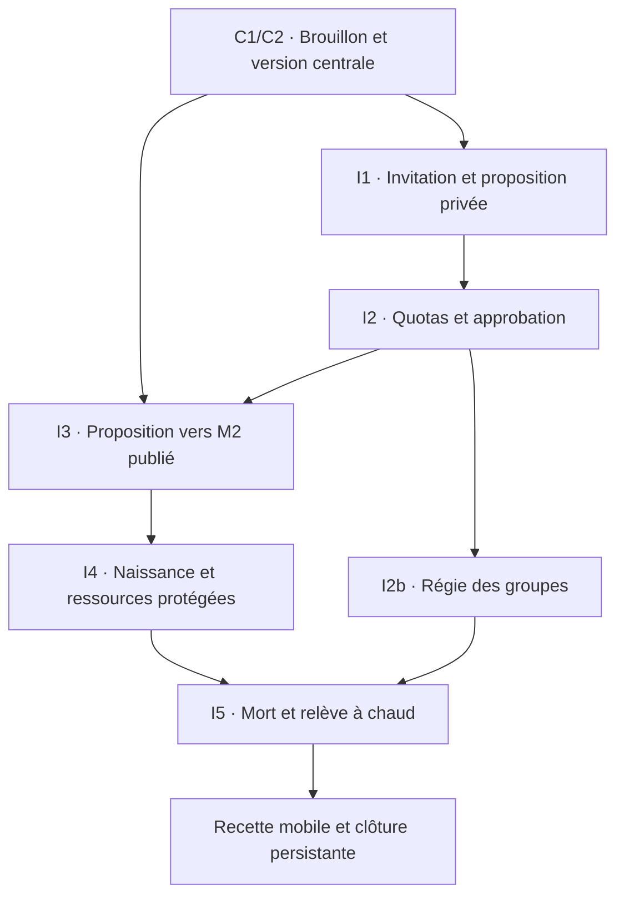

# SO-00 V3.5 — diagnostic, inscriptions et ordre de développement

## Avancement après C1e

[C1e — fiches narratives M2](SO-01-C1E-PERSONNAGES.md) : identité/nature, textes privés, objectifs avec étapes et relations orientées dans le brouillon commun, avec références différées, délégation M2 et archive/restauration auditée. **957 tests applicatifs locaux et build réussis** ; 20 nouveaux cas métier partagés avec Firestore, quatre UI et un HTTP/Auth. CI du SHA exact à consigner dans la PR après terminaison. Aucune candidature convertie, instance, dotation ou publication créée. Profils canoniques, XLSX M2, contrôle global C2, I3/I4/I5 et recette humaine restent incomplets ; les 55 verdicts complets sont inchangés.

## Avancement après C1c

[C1c — recettes dans le brouillon central](SO-01-C1C-RECETTES.md) : édition/archivage/restauration M4, références M1 différées, diagnostics privés et délégations M4 distinctes. **908 tests applicatifs locaux et build réussis** ; 14 nouveaux cas métier partagés avec Firestore, quatre rendus UI et un HTTP/Auth. CI du commit exact à consigner dans la PR après terminaison. Aucun import central ni publication/fabrication ; M5, personnages M2, naissance/relève et recette mobile restent à développer. Les 55 verdicts complets restent inchangés.

## Avancement après C1b

[Brouillon central et droits C1b](SO-01-C1B-BROUILLON.md) : M1 éditable et M2 narratif consultable dans le même brouillon, délégations de campagne, réessais/concurrence et archive/restauration auditée. 890 tests locaux et build réussis ; CI exacte dans la PR. C1 reste à compléter par les adaptateurs/références, C2 par la publication globale ; passage personnage M2 I3, naissance I4 et relève I5 restent absents. Aucun ancien contrat migré.

## Avancement après I2b

[Régie des groupes I2b](SO-01-I2B-GROUPES.md) développée sans migration historique : 869 tests locaux et build réussis, CI exacte dans la PR. Affectation/retrait/transfert, capacité/type/responsable, autorisation explicite des mandats, archive et contre-opération auditée. Données financières et propriété inchangées. Préparations I2 sans personnages : accès à cette régie différé au raccordement I3/I4. Suite C1/C2 puis I3/I4/I5 ; les sections suivantes conservent le diagnostic initial.

## Avancement après I2

[Décisions MJ et quotas I2](SO-01-I2-DECISIONS.md) ajoutés sur C1a/I1, sans migration historique : 846 tests locaux et build réussis, CI exacte dans la PR. File filtrable, confirmations par classe/globales, unicité fictive, correction/refus/attente/retrait, exception motivée et changement de classe atomique. Le diagnostic ci-dessous est conservé comme état initial ; M2 central et naissance restent absents. Prochaine tranche I2b, puis C1/C2/I3/I4.

23 octobre 2026. **Première étape V3.5 : audit différentiel et tests du socle, pas livraison du parcours d’inscription.** L’application reste en 0.37.0 sur branche. Aucun service de production, schéma applicatif, ancien Master, compte, règle Firebase ou marqueur de déploiement n’est modifié par cette tranche. L1a–L1m, SO-06a, SO-01a et SO-06b sont conservés.

Le parcours cible exige des commandes nouvelles autour des services existants : **candidature privée → admission contrôlée → définition M2 → naissance de session**. La relève et les changements d’appartenance sont des opérations de session. Ils ne doivent ni réimporter le scénario ni déclencher la publication du Master. La priorité SO-01 est réordonnée ci-dessous ; il n’est pas nécessaire d’attendre la fin de SO-06 pour livrer la régie des groupes.

## 1. Références et état effectivement inspecté

| Référence | Preuve / portée |
|---|---|
| [CDC V3.5](source/SO_CDC_V35.md) | Fichier joint SO_CDC_V35(1).md, **839 lignes lues intégralement**, SHA-256 `531ed5dba4c3c3970c5500db25cfc07df8dc434408a62b82783c0b2512be92d4`. Copie exacte, espaces Markdown compris. §§3, 4.7–4.11, 8.4, 9, 10, 11.1 quinquies et D gouvernent ce diagnostic. |
| [Livre V0.7](source/SO_Regles_V07.txt) | Source DOCX SHA-256 `7f9cb723e5395d643dffa636a626498fe01d1b1f3a8c421a88a60c2725b1fd73`, identique au livre intégralement lu dans les tranches précédentes ; chapitres création, progression, mort et succession relus. A01–A38 et FOR-01 clos. |
| Sept gabarits V0.1 | ZIP SHA-256 `8af50e64b0363d1b4fc9bc1278be44389b55d57bd91957df80ced55c97f8e9be`, inchangé. [42 feuilles métier/références rapprochées du code](SO-00-V34-GABARITS.md), [extraction](source/SO_Masters_V01.audit.json). Vides, non certifiés, aucun nouveau catalogue canonique déduit. |
| [Vade-mecum](source/SO_Vademecum_V01.txt) | DOCX SHA-256 `4b134d69b4348b3da8e8adbd4de88811c4f5c27b2f708359fbb6881a1b3d24fc`, inchangé, transcription intégrale relue. Préparer/importer dans le brouillon, contrôler globalement, publier une version. |
| [Plan V3.4](SO-00-V34-PLAN-CENTRAL.md) | Architecture centrale conservée : préparation immuable puis bascule atomique, garde de version parent, pas de seeds dans l’import central. Cette tranche ajoute le raccordement M2/admissions/session, sans exécuter ce plan. |

Les reliquats éditoriaux du CDC (A.1 « version 0.6 », rapport V0.7 en introduction/V0.6 en annexe C, §8.3 « chaque Master ») subsistent. V0.7 fait autorité pour le jeu, §3 V3.5 pour la publication globale ; les historiques locaux d’ateliers ne deviennent pas sept autorités. Aucun arbitrage de jeu n’est rouvert.

| GitHub au début de la reprise | État vérifié |
|---|---|
| `main` | [`03eaace155b052d1b7d1960347746e9ee60ed514`](https://github.com/gkerckhofs-a11y/gn-engine/commit/03eaace155b052d1b7d1960347746e9ee60ed514), 0.36.0 |
| Branche retenue | `work/l1-modular-workshop`, [`54c7868c3b2ed9222bdffb99077ef7a96925f968`](https://github.com/gkerckhofs-a11y/gn-engine/commit/54c7868c3b2ed9222bdffb99077ef7a96925f968), 0.37.0 ; seule [PR ouverte #1](https://github.com/gkerckhofs-a11y/gn-engine/pull/1), en brouillon, non fusionnée |
| Checkout | Propre avant cette tranche ; HEAD local `73bd25e9380483022fde6fe76fc4426b25d039fe`, même arbre que le distant : `adef328dc7d9eed5cb7aed0d43a6e0cfcd9ed490`. SHA locaux/distant distincts, arbres comparés. |
| Autres branches | `codex/mission-participation-0.18` : `7072cda44252d2fded85bfe9661240140eed0a61` ; `codex/open-bounties-0.17` : `787ffbdc3d17b768a0bb44aab6a4d1bb015a871a`. Aucune fusion/suppression. |
| Tags | `git/matching-refs/tags/` retourne une liste vide. |
| CI de la base | Push [39959884384](https://github.com/gkerckhofs-a11y/gn-engine/actions/runs/39959884384), PR [39959889744](https://github.com/gkerckhofs-a11y/gn-engine/actions/runs/39959889744). **Succès final des deux runs**, logs récupérés : build + **793 applicatifs et 611 Firebase chacun**, zéro échec/annulé/ignoré/todo. Jobs 120434915403 (fin 13:38 UTC) et 120434934407 (fin 13:40 UTC), Node 22.23.3, Java 21.0.12+1. Fusion virtuelle PR `05019f0050ed4af8359e8eac42d7c8ec83d85183`. Ces preuves portent sur 54c7868c, pas sur le nouveau commit. |
| Dernier déploiement recensé dans l’audit précédent | Run [39731774273](https://github.com/gkerckhofs-a11y/gn-engine/actions/runs/39731774273), SHA `d5334d8dfcb493421c9bd4efaf83c50eb56e373f`, succès 22 octobre 06:24:29 UTC. Métadonnée historique, pas vérification de l’état réel du site aujourd’hui. |

`check.yml` est relu : build, `npm test`, Auth/Firestore/Storage Emulator sur `demo-gn-engine`, Node 22/Java 21, timeout 25 minutes. `deploy-firebase.yml` reste séparé (manuel ou marqueur sur main) ; `verify-live.yml` n’est pas exécuté. Aucune commande ne consulte des comptes/données de production. Résultat de la CI du **nouveau commit** à citer séparément dans la PR, jamais déduit de la base.

## 2. Matrice V3.5 / code réel / tests / adaptation minimale

Toute la matrice porte sur la branche ci-dessus, et non sur main supposé équivalent. « Présent » signifie une brique réutilisable ; les preuves historiques ne valident pas le parcours complet INS. Les suites `test/support/*-suite.mjs` mentionnées sont appelées par les tests MemoryStore **et** `test/integration/firestore.test.mjs`.

| Exigence V3.5 | Déjà présent | À adapter / nouveau | Tests et preuve disponible | Risque données / priorité |
|---|---|---|---|---|
| Authentification obligatoire | `server/index.mjs` vérifie le jeton Auth ; `workflow.signed` exige Google vérifié | Réutiliser l’UID Auth ; ne pas créer un second compte participant. Garder l’admission distincte de l’accès au personnage | `workflow-suite`, HTTP émulateur, révocation de jeton | Pas de modification Auth/IAM ; SO-01-I1 |
| Lien d’inscription expirant/révocable | `invitations/{hash}`, `issueInvitation/redeem`, heure serveur, empreinte seule | **Nouveau but admission**. L’invitation actuelle exige une attribution préalable et ouvre la fiche privée ; ne pas réutiliser son jeton pour proposer un personnage | Expiration, consommation concurrente, ancien jeton ; sonde AUD-INS-06 | Distinguer les buts et portées, pas de fuite de jeton ; I1 |
| Dossier brouillon/reprise/correction | `registrations/{hash(uid)}`, réponses privées, statut et identité civile | Proposition révisée séparée dans la même inscription, historisée, transitions serveur et projection dédiée ; pas de `character` actif | AUD-INS-04/05 : inscription automatique ACCEPTED selon capacité globale ; champs libres non canoniques | Ne pas recycler `ACCEPTED` comme preuve d’approbation MJ V3.5 ; I1 |
| Prénom/nom fictifs uniques | `public.displayName`, `biography`, portraits, distinction public/privé | Champs fictifs séparés, clé normalisée de collision, réservation atomique à la confirmation ; afficher le périmètre session | AUD-INS-01 : deux noms affichés identiques acceptés ; projections testées | Aucune normalisation rétroactive des noms/IDs ; I1 |
| Espèce/nature | `character-nature`, HUMANOID/DROID, soins filtrés SO-01a | Catalogue narratif administré, stable ID, nature validée depuis ce catalogue ; disponibilité contrôlée au serveur | `character-nature-suite`, tests UI et migrations sans réécriture | Pas de bonus ou nouvelle aptitude par texte d’espèce ; I1/C1 |
| Huit classes et initiation N1 | `skills`, `classes`, `abilityProfile`, éditeurs L1c/h/i | Profil SO fermé liant codes canoniques aux vrais IDs, trois principales N2/fixes, une initiation parmi les huit hors classe, cinq secondaires max | `abilities-suite` protège droits/snapshots, **pas** les règles A08. AUD-INS-05 n’accorde aucun pouvoir malgré texte Force | Ne pas transformer le catalogue libre historique en liste joueur ; I1 puis I4 |
| FOR-01 uniquement PNJ | Accès catalogue réservé aux organisateurs ; projections explicites | Garde de profil PNJ serveur et projection cachée encore manquantes ; liste blanche de choix joueur obligatoire | Pas de recette FOR complète exécutée | Ancien profil publié peut exposer nom/classe : ne pas le réutiliser tel quel pour Force ; I1/SO-02 |
| Quotas atomiques par classe | `capacity/accepted` et `register` transactionnels | Configurations par classe de session, places confirmées par participant, réservation durable à l’approbation ; revérifier à la naissance ; attente, retrait et exception MJ motivée | Test historique dernière place **globale** ; AUD-INS-04 ne teste aucun quota de classe | Pas de compteur dans Excel ou navigateur faisant foi ; I2 |
| Souhaits d’amis | Réponses libres privées ; appartenances `groups.members` réelles | Demande privée sans droits, consentement pour lien à une autre personne, choix explicite MJ | Groupes/sécurité testés, aucune INS-05 complète | Ne pas envoyer les identités civiles d’amis ni créer une affiliation ; I1/I2 |
| File et approbation MJ | Régie inscriptions/assignation ; `staff` OWNER/MJ/RECEPTION | File filtrable, corrections/attente/approbation, révision et autorisation content/campagne ; l’accueil n’approuve pas le personnage | Tests rôles et réessais après révocation | Le `assign` actuel autorise RECEPTION ; empêcher ce contournement dans le futur mode SO ; I2 |
| Préparer M2 sans dotation | Masters, diff, provenance et confirmations L1 | Conversion déterministe proposition approuvée → unique définition du brouillon central ; aucune identité civile dans exports M2 | Suites Masters, sondes V3.4 ; publication centrale non implémentée | **Dépend de C1/C2 V3.4** ; ne pas appeler apply SESSION historique ; I3 |
| Publication avant session | Versions figées et `campaigns` | Parent CAS, graphe global, référence à version READY et entrée en vigueur ; voir plan V3.4 | MST toujours non exécutés de bout en bout | Ne pas publier M2 seul ; I3/C2 |
| Affectation/QR à la naissance | `assign`, lien privé, `publicBadge`, `assignedUid` | Commande distincte atomique et reçue, autorisation/état/quotas, activation du QR après naissance, pas de réattribution d’une réserve déjà incarnée | AUD-INS-03/07 : badge avant attribution et réattribution d’une identité déjà ouverte possibles dans le contrat historique | `assign` n’est pas une succession ; sessions anciennes inchangées ; I4 |
| Kit et 200 Cr protégés une fois | `seedWallets`, `seedInventory`, `accounts`, `inventory`, `ledger` | Naissance seule déclenche dotation canonique ; tranche protégée et restrictions transversales de dépense/transfert/vente ; kit non transférable/revendable/pillable | AUD-INS-02 : 200 Cr **ordinaires** avant affectation ; suites économique/inventaire idempotentes | Tous les débiteurs, réservations et lots doivent respecter la protection avant activation ; I4 |
| XP/PA participant | PA 5/8, horloge 300 min, réservations, `globalLevel` sur caractère | Progression attachée au participant, 3 XP/session, niveau 2 après quatre sessions terminées, compteur carrière acquis séparé des hérités, achats bornés | `action-points-suite` : pause/reconnexion/plafonds ; pas de progression XP A08/A09 | Ne pas inférer le niveau d’un nouveau participant depuis le personnage réattribué ; I4/I5 |
| Mort et remplacement en jeu | PV/urgence/soins/horloges et interdictions d’action partielles | Mort canonique et révocation, réserve jamais incarnée ou nouvelle proposition sous profil publié, nouvelle identité/PA/kit/crédits, héritage calculé | Santé/personActions partiels ; aucune INS-07/08 complète | Ne pas réinitialiser l’ancienne fiche ; aucun transfert de fortune/dettes/secrets ; I5 |
| Administration des groupes | `saveSessionGroup`, UI `web/groups`, membres/droits explicites, historique et motif | Type équipe/faction, place principale et capacité configurées ; assigner/retirer/transférer atomiquement entre deux groupes ; responsable/archivage explicites | `groups-suite` : concurrence et droits ; mutations de session déjà sans publication | Pas d’unicité imposée aux factions narratives ; conserver caisses/stock ; I2b |
| Révocation vs caisse | `accessAccount` relit membre/permissions dans la transaction ; garde sur reçu et confirmation | Réutiliser pour nouvelle commande de transfert ; couvrir aussi secrets, stockage, pilotage, contrats | **Deux tests nouveaux** `INS-10 partiel` dans `collective-suite`, deux ordres de lancement ; une dépense commise avant révocation reste acquise | Pas de promesse d’annuler un paiement déjà effectué ; I2b/I5 |
| Portrait candidat | Pipeline privé médias, normalisation, validation, slots de fiches | Autoriser upload limité à sa proposition, sans ouvrir la médiathèque ; consentement/projection avant publication | Media/HTTP tests existants ; pas de portrait de proposition actuellement | Facultatif mais à livrer ; aucune URL distante libre ou métadonnée civile publique ; I1b/I3 |
| 55 recettes + sécurité/mobile | Suites automatiques existantes et registres SO | Registre V3.5 complet, données fictives, vrais Android/iOS et comptes isolés | [55 cas ciblés](SO-RECETTES-V35.md), 10 SEC séparés | Émulateur ≠ téléphone ni recette humaine ; G5 ouvert |

Les primitives d’import, de compte, de lot, de compétence, de QR, de média et de permission restent propriétaires de leurs données. Aucun nouveau moteur ou catalogue de commerce/personnages en parallèle n’est proposé.

## 3. Ce qui a été exécuté dans cette tranche

**Sept sondes diagnostiques** `node docs/verification/so35-audit.mjs`, sur un MemoryStore jetable et des données fictives : doublon de nom accepté, crédits ordinaires avant affectation, badge public avant affectation mais sans secrets, inscriptions sans lien limitées à capacité totale, texte Force stocké sans aptitude accordée, invitation privée impossible avant attribution, réattribution d’un personnage déjà activé avec révocation de l’ancien accès. [Résultats exacts](verification/so35-audit-probes.json). Elles caractérisent le contrat existant ; elles ne doivent pas devenir des tests exigeant le maintien de ces écarts dans le futur mode SO.

**Deux tests métier nouveaux** dans `test/support/collective-suite.mjs` exercent, avec les vrais services, révocation du droit de dépense et paiement concurrents, dans les deux ordres de lancement. Après les deux réponses : droit révoqué, aucun nouveau débit ou reçu récupérable par l’ancien mandat ; paiement éventuellement sérialisé avant révocation conservé, total comptable et anciens journaux intacts, caisse et versions de scénario inchangées. Le test n’impose pas l’ordre choisi par Firestore. Il est partagé avec la suite émulateur. Ce n’est pas encore un transfert entre groupes, ni une naissance/releve, ni une preuve Android/iOS.

| Contrôle local, Node 24.19.0 | Résultat réellement observé |
|---|---|
| `node --test test/collective.test.mjs` | 22/22 réussis ; sous-ensemble de la suite suivante, ne pas additionner |
| `npm test` | **795/795 réussis**, 0 échec/annulé/ignoré/todo, 15 174,180597 ms ; [log](verification/so35-npm-test.log) |
| `npm run build` | Succès ; [log](verification/so35-build.log) |
| Sondes SO-00 V3.5 | 7 observations reproduites, assertions réussies ; hors compte des 795 |
| Firebase local | Non exécuté ; runtime local Java 17, CI Java 21. Le verdict émulateur doit être lu dans GitHub Actions sur le nouveau commit |
| Android/iOS, comptes isolés sur téléphones, charge 60 | **NON TESTÉ**. Aucun appareil/environnement de recette mobile n’est attesté par cette tranche |
| 55 recettes complètes | Aucune nouvelle validation intégrale ; preuves partielles détaillées dans le registre. Aucun succès INS revendiqué |

La dernière CI de la base et la CI exacte de cette tranche sont journalisées dans la PR avec SHA/run/job, versions d’outils, décomptes et conclusion après achèvement. La documentation ajoutée ne change pas l’app ni le build servi. Les quatre binaires Masters et `.github/deploy-request.json` demeurent identiques à la base.

## 4. Architecture minimale proposée — extensions, pas migration exécutée

### 4.1. Emplacements et frontière des données

| Emplacement existant / extension proposée | Responsabilité |
|---|---|
| `sessions/{sid}/registrations/{hash(uid)}` | Réutiliser le lien compte/session et la projection propriétaire du dossier. Ajouter sous état versionné `admission` la proposition privée, son statut, numéro de révision, souhaits et références approuvées. Ne pas recopier le compte Auth ni mettre ces données dans M2. Si plusieurs tentatives/successeurs, historique immuable de propositions et pointeur courant unique. |
| `invitations/{hash(token)}` | Ajouter **purpose ADMISSION** et contexte campagne/session, expiration, révocation, compte visé ou limite d’usages explicite. Anciennes entrées sans purpose gardent leur sémantique PRIVATE_ACCESS ; jamais interchangeables. Séparer le reçu de consommation lié à l’UID du jeton, ne pas journaliser son clair. |
| `sessions/{sid}/admissionQuotas/{classId}` et clés d’identité | Extension proposée : max confirmé, compteur et révision ; reçus individuels dans l’inscription pour éviter double compte. Clé normalisée du nom/prénom dans cette session, collision contrôlée en transaction. La configuration seule ne réserve aucune place. |
| Profil SO versionné et catalogue narratif | Les règles fermées référencent `classes`/`skills` existants par IDs durables avec codes canoniques ; les espèces narratives appartiennent à la configuration de campagne centrale. Pas de bonus, prix ou liste d’espèces inventés. La préparation avant première publication peut sélectionner le profil décidé, mais l’activation exige une version publiée valide. |
| `campaigns/{cid}/masterDrafts` proposé en V3.4 | L’approbation produit un patch M2 à ID stable + provenance privée, selon la même révision que les autres ateliers. M2 contient la fiction autorisée ; pas d’email, UID d’ami, lien d’inscription, notes d’admission. Pas de second catalogue `Character`. |
| `sessions/{sid}/characters/{id}` | Même collection pour les instances ; ajouter, en mode SO explicite, cycle jamais-incarné/actif/mort/retiré et reçu de naissance, référence au profil/version autorisés. Une réserve n’a aucune dotation jouée avant naissance. |
| Participation/progression de campagne | Extension privée indexée par UID existant (sans second compte) pour sessions jouées, XP en attente, niveau global ; carrière/XP hérités séparés par personnage. Copie des épisodes et clôture à adapter explicitement, sans déduire rétroactivement une carrière de logs incomplets. |
| `groups/{gid}.members` et ses historiques | Conserver ce stockage d’appartenances comme autorité. Ajouter seulement métadonnées de type/capacité/responsable si approuvées ; les demandes d’amis sont séparées. La commande de transfert modifie source/destination ensemble, pas une seconde collection d’appartenances divergente. |
| `operations`, `audit`, comptes, lots, médias | Réutiliser reçus/idempotence, journal, ledger, réservations et pipeline image. Nouveaux événements référencent les instances existantes, sans collection économique parallèle. |

Les noms d’extensions ci-dessus sont **proposés**, pas des chemins déjà actifs. Choisir le contexte concret de session pour appliquer les quotas. Un lien de campagne doit résoudre une session d’admission explicite, jamais « la dernière session » implicitement. Pour une campagne neuve sans épisode, C1 doit permettre une préparation sans appeler le seed historique ; l’inscription ne peut précéder ce contexte stable en production.

### 4.2. Commandes et invariants de concurrence

1. **Ouvrir / consommer un lien d’admission** : autorité MJ et périmètre vérifiés, expiration en temps réel, état révoqué prioritaire ; utilisateur authentifié. Un double appel du même utilisateur retrouve son dossier/reçu si l’accès reste autorisé, sans consommer deux places du lien. La révocation bloque nouvelles consommations/modifications dépendant du lien ; une admission déjà accordée n’est pas annulée silencieusement. Fermeture, retrait et révocation d’accès sont des opérations explicites distinctes.
2. **Sauver / soumettre / corriger** : un dossier courant par participant et contexte ; contrôle de révision, refus des champs de privilège, listes de classes/initiation validées serveur. Le texte libre reste texte échappé, sans interprétation de règle. Les collisions de noms ne révèlent pas l’identité civile du détenteur. Un souhait de groupe n’appelle jamais `saveSessionGroup`.
3. **Approuver** : relire le rôle, proposition, politique et quotas dans une transaction ; confirmer une place par participant, pas par définition en réserve. Les huit maxima sont configurés explicitement, entiers positifs ou nuls ; zéro ferme la classe, absence de configuration ne signifie pas illimité. Refuser une baisse sous l’effectif confirmé sans régularisation explicite. Pas de réservation temporaire dans la première tranche (option du cahier non nécessaire). En cas de dernière place prise, retour attente sans augmentation de compteur. Répétition par un autre requestId du même dossier déjà approuvé n’ajoute rien. Changement de classe confirmé = libération/prise atomiques. Exception au quota : commande MJ motivée et traçable, jamais un booléen joueur.
4. **Préparer M2 / publier** : conversion idempotente par identité de proposition approuvée ; contrôle global base+patchs M1–M7, version immutable READY puis CAS du parent/pointeur. Blocage global sans effet joueur s’il manque une référence. M1/M4/M5 et M3 seul restent les tests centraux requis ; aucune publication spécifique à l’inscription ne les contourne.
5. **Naître / affecter** : dans la même transaction, revérifier autorité, session, profil publié, quota/place confirmée, participant sans autre actif, personnage éligible et reçu de dotation absent ; écrire incarnation, liaison inscription, compétences, PA, kit, 200 Cr protégés, badge public et reçus/audit. Retenter avec le même ID ou un nouvel ID sur la même naissance ne dote rien de plus. Aucun lien privé n’apparaît dans la projection du badge. La naissance à chaud issue du profil publié n’a pas besoin d’un nouveau pointeur de campagne.
6. **Mourir / relever** : l’état de mort canonique met fin aux actions et aux anciennes autorisations, ferme la participation et libère sa place une seule fois ; les réservations en cours doivent être résolues/interrompues selon leurs règles. Ancienne identité et journaux conservés. Le successeur distinct reçoit `min(9, floor(carrièreAcquise/4))` XP, hors hérités et XP non attribués de cette session. PA 5/8 pleins, prochaine échéance commune inchangée ; nouveau kit et 200 Cr une seule fois. Kit initial de l’ancien personnage retiré du jeu avec trace (pas effacement historique), fortune personnelle et secrets non transférés. Réserve validée jamais incarnée ou nouvelle proposition à chaud restent les deux chemins.
7. **Affecter / retirer / transférer un groupe** : lire personnage et groupes source/destination dans la transaction, contrôler capacités/configuration, droit MJ et révisions ; désactiver l’ancien mandat et ses permissions, attribuer seulement les nouveaux droits explicitement confirmés. Historique lié `characterId`, ancien/nouveau groupe, session, opérateur, motif, date. Caisse, propriétaire des biens, reçus et transactions antérieures inchangés. Les consommateurs relisent les mêmes documents de groupe : un débit après commit de révocation est refusé ; un débit commis avant demeure valide. Aucun republish. Une contre-opération auditée peut restaurer une appartenance, pas annuler le jeu effectué.

L’unicité porte sur **un actif par participant et session**, avec un reçu persistant « déjà incarné » pour la réserve au niveau campagne. Ne pas utiliser `assignedUid === null` comme preuve « jamais joué » : cette valeur est également celle des personnages désattribués. Une appartenance narrative préalable de réserve est montrée au MJ et contrôlée, jamais convertie en nouveau mandat de caisse par défaut.

### 4.3. Dépendances et ordre minimal de livraison

| Tranche à développer | Parcours complet et limite de livraison | Dépendance / sortie vérifiable |
|---|---|---|
| **C1a — Contexte de préparation sans seed, SO-01** | Sous-ensemble initial du plan central : campagne/session d’admission identifiée, profil et autorités explicites, aucune ressource créée. Pour une nouvelle campagne, nécessaire avant ouverture réelle d’I1 | Nouvelle préparation synthétique puis opt-in autorisé ; pas de conversion d’une campagne historique. La publication complète C2 n’est pas nécessaire pour recevoir une proposition privée |
| **I1 — Admission privée, SO-01** | MJ ouvre/révoque un lien lié à un contexte préparé ; authentification ; espèce/nature, classe/initiation, identité, background et souhaits ; sauvegarde/soumission/correction, statut visible au seul candidat/MJ. Aucun rôle ni personnage actif | Profil SO fermé minimal et contexte de préparation ; INS-01/02/04/05 automatisés. Réutiliser HTTP/Auth/registrations, pas `register` ouvert comme contournement. Portrait facultatif dans I1b si son autorisation média ne peut entrer dans ce commit |
| **I2 — Quotas et décision MJ, SO-01** | File, compteurs, dernière place atomique, attente, retrait, exception motivée ; approbation sans kit/argent/QR | I1 ; INS-03, deux appareils/MJ, répétition d’approbation et révision périmée. Place confirmée unique ; capacité globale également respectée |
| **I2b — Régie groupes, SO-01/SO-06** | Créer/archiver, responsable, affecter/retirer/transférer avec capacité configurée, permissions et contre-opération ; vrais comptes/stock inchangés | Réutilisable avant succession ; tests INS-09/10 partiels puis complets avec I5. Deux groupes dans une transaction ; confirmer l’impact des anciens accès et des opérations en cours |
| **C1/C2 puis I3 — M1/M2 et publication, SO-01** | Brouillon commun, droits campagne, séparation seeds/import, publication globale/rollback selon V3.4 ; approbation vers M2 unique et publication avant session | I2 pour entrée M2 ; MST-01…04/07/09/10 selon couverture, aucune activation tant que ces barrières manquent. Une nouvelle version ne redistribue rien |
| **I4 — Affectation canonique, SO-01** | Activer la définition autorisée : trois principales, initiation, progression participant/PA, kit, 200 Cr protégés et QR ; empêcher dons/vente/revente/dotation répétée dans **tous** les chemins de transaction | I3 + registre de kits M1 + gardes économiques/inventaire ; INS-06 et SO-01/02/03/24. Ne pas livrer une naissance dont les crédits protégés restent transférables |
| **I5 — Mort et deux relèves à chaud, SO-01/02/06** | Mort confirmée canonique, réserve jamais jouée ou nouvelle création sous profil publié ; XP/PA et dotations, révocation ancienne identité/groupes, réaffectation explicite | I4 + santé/mortalité/STOP + I2b ; INS-07…10, mort répétée même session, panne avant/après commit, courses de remplacement, aucun republish |
| **Suite SO-02…06** | Compétences/FOR/labo ; droïdes ; M3 spatial ; M4/M5 commerce ; M6/M7 et A38, sans abandonner les lots existants | La recette globale conserve 55 cas + 10 SEC ; I5 ne peut attendre une refonte universelle mais exige les règles de mort et les ressources sûres |

L’ordre est celui des dépendances, pas sept migrations ni sept publications. C1a est le prérequis réduit d’I1 pour une campagne neuve ; le reste de C1/C2 complète ensuite le brouillon et la publication avant I3. I2b peut avancer dès que son contexte et les autorisations sont stables ; I1 ne doit pas être présenté comme un personnage jouable. Le **premier parcours activable complet** est I1→I2→I3→I4. Cette découpe évite d’annoncer INS-06 livré alors que la publication centrale et les crédits protégés sont absents.

## 5. Compatibilité, migration et retour arrière

Les développements additifs sur branche et les données fictives sont autorisés. La consigne V3.4 « Attendre validation de ce plan avant opérations de migration » reste une barrière pour l’adoption/conversion d’une campagne ; ce diagnostic ne réalise aucune opération de migration. La nouvelle spécification de jeu est décidée, les noms de chemins et l’organisation technique ci-dessus sont des propositions d’implémentation.

- Activer le futur mode SO par en-tête/profil explicite. Les anciennes campagnes sans ce marqueur restent sur leurs contrats historiques. Les nouvelles routes doivent refuser les anciennes mutations qui permettraient de contourner invitation, quotas, naissance ou restrictions SO ; conserver leurs tests dans le mode historique.
- Ne pas renommer d’IDs/QR. Nom d’affichage Breach Port seulement. Préserver `masterVersion=1`, les quatre binaires et toutes les lignes historiques. Les nouvelles colonnes/propositions passent par un contrat séparé/adaptateur explicite ; le gabarit M2 ne contient pas les identités civiles ni les jetons.
- Une campagne opt-in déjà jouée exige aperçu/sauvegarde/accord : repérer soldes/kit déjà distribués, personnages déjà incarnés, noms en collision, appartenances multiples et progression inconnue. **Ne pas deviner les XP historiques ou remettre des ressources pour “compléter”**. Si la donnée n’est pas déterminable, anomalie à régulariser explicitement, pas zéro silencieux.
- Compléter la copie d’épisodes et les archives autorisées pour les nouveaux reçus/progression. Le transfert d’un pointeur Master ne restaure jamais un état vivant. La nouvelle incarnation à chaud garde sa provenance/version de règles ; sa consolidation M2 pour l’épisode futur est une préparation distincte.
- Pour cette tranche d’audit/tests : retour du code par revert du commit sur branche, sans compensation de données car aucune donnée applicative n’a été écrite. **Revert non exécuté** ; pas de migration à inverser. Pour les futures tranches : conserver les reçus/quota/progression/dotation et bloquer les écritures incompatibles lors d’un rollback logiciel ; ne jamais supprimer ces marqueurs puis rejouer une naissance.
- Avant adoption réelle : démontrer sauvegarde/restauration cohérente Auth/Firestore/Storage en environnement isolé, incluant jetons hachés, admissions et historique privé, progression, quotas, pointeurs, reçus, comptes/lots/ledger, médias et permissions. Tester interruption avant/après commit et reprise sans nouveau droit ou nouveau kit. L’archive `.gnscenario.zip` seule n’est pas cette sauvegarde.

La [procédure de sauvegarde et déploiement](SO-SAUVEGARDE-DEPLOIEMENT.md) reste **À FAIRE VALIDER**, non lancée. Projet/URL de recette mobile, appareils disponibles, RPO/RTO et sauvegarde complète restaurée : non établis à ce stade. Aucun blocage de production n’est contourné par une permission Firebase/IAM/DNS.

## 6. Verdict et anomalies

**Diagnostic livré sur branche ; application complète V3.5 non conforme, non prête au GN.** Écarts ajoutés : SO-GAP-14 admission/proposition/quotas/approbation ; SO-GAP-15 naissance/succession/progression/protection des ressources et QR ; SO-GAP-16 régie de transfert entre groupes, capacité et révocation liées à la relève. Les écarts V3.4 SO-GAP-12/13 et les règles SO-GAP-01…11 restent ouverts.

G0 dispose des sources, du diagnostic et de contrôles, sans sauvegarde complète restaurée. G1–G5 ne sont pas franchis. Les résultats automatisés ne sont pas des recettes Android/iOS. La prochaine tranche fonctionnelle est **I1**, avec son contexte de préparation explicite ; aucune naissance, migration ou publication globale ne doit être simulée en attendant les dépendances.
