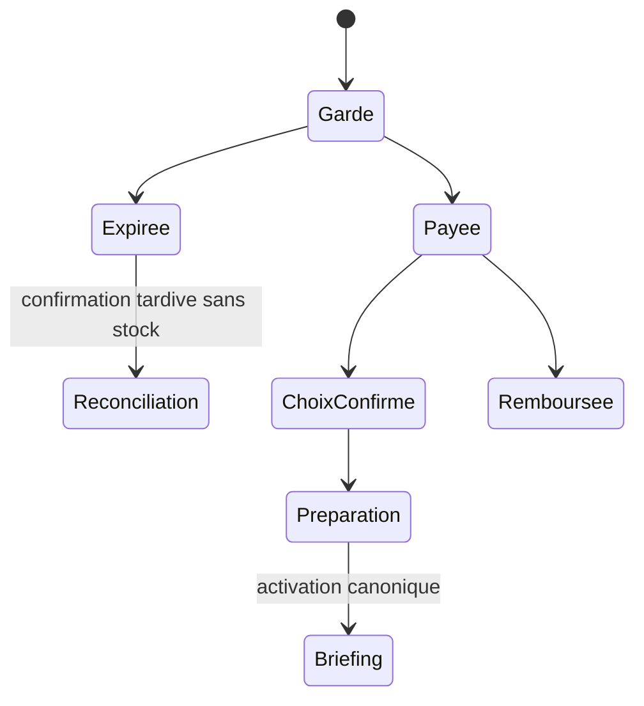

# Space Outlaws · Inscription des joueurs

## IN-00 · Audit du 26 novembre 2026

Base `0ef741457992230f7fe374a9dfc6a7dc547bd8ed`, [vérification réussie](https://github.com/gkerckhofs-a11y/gn-engine/actions/runs/45164556587). La PR #2 est close. La PR #61 concerne le cockpit et reste sur sa propre branche. La billetterie démarre sur une branche neuve depuis main.

| Parcours | Existant contrôlé | Adaptation retenue |
|---|---|---|
| Accueil, catalogue | Liens individuels de session dans le routeur | Vitrine publique distincte, projection explicite de la session publiée |
| Inscription | Google vérifié, candidature, proposition M2 et quotas | Mode PREMADE_PAID exclusif sur une préparation vide. Le mode historique conserve son contrat |
| Paiement | Crédits fictifs dans payments.mjs | Commande en centimes EUR, reçu de prestataire simulé côté serveur, uniquement en environnement de test |
| Choix | Définitions publiées, roster et attribution par la régie | Version figée, sélection exclusive en transaction et teaser rédigé séparément |
| Naissance | birthPlan exige une candidature approuvée, puis planSoBirthAssets, soBornCharacter et writeSoBirthAssets | Vérifier le billet et le verrou de rôle dans un plan distinct. Réutiliser la transaction native d’incarnation au briefing |
| Terminal | mySession contrôle affectation, phase et accès | Projection pré-jeu limitée au titulaire puis lien vers le terminal natif |
| Régie | Propriétaire et délégations par session | Contrôles serveur, suivi et corrections tracées, sans export de secrets de fiction |

Les commandes identifient le participant par son compte vérifié. Chaque lecture recalcule les disponibilités à partir des billets, des gardes non expirées et des rôles publiés. Les mutations concurrentes utilisent la même transaction et le même document de session de vente. La participation commerciale vit dans la billetterie, puis la naissance crée l’inscription native active. Le retour de checkout relit le statut serveur. Le calendrier, le prix final, le contact, les consignes et les textes légaux sont des données de configuration.

Aucune migration des sessions historiques. Risques à vérifier en recette : concurrence à la dernière place, confirmation tardive, réexposition d’une fiche privée après correction et double dotation à la naissance. Un compte marchand, une politique commerciale approuvée et un canal de courriel autorisé seront nécessaires pour une commercialisation. Le simulateur fonctionne indépendamment de ces accès.
