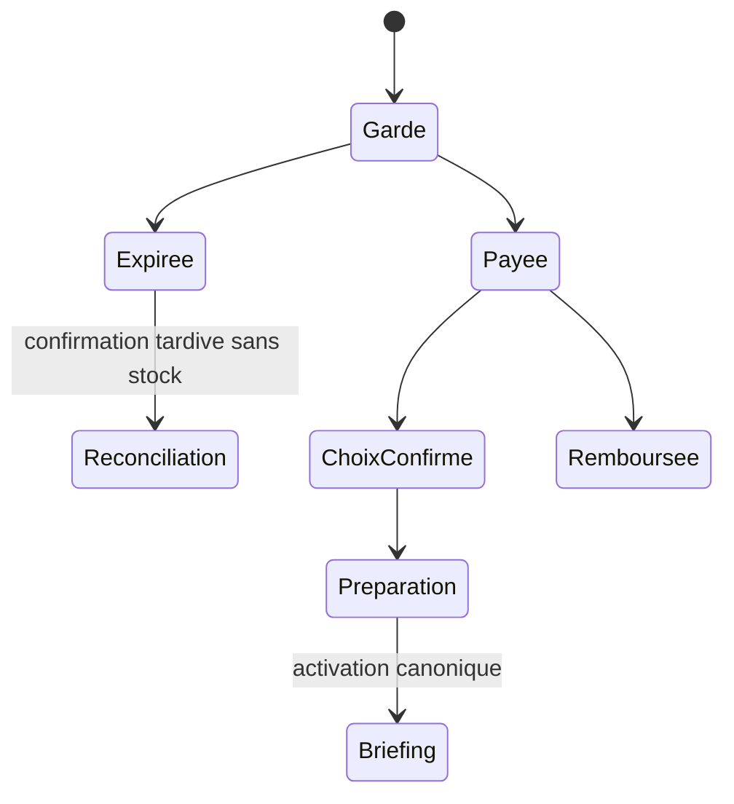

# Space Outlaws · Inscription des joueurs

## IN-00 · Audit du 26 novembre 2026

Base `0ef741457992230f7fe374a9dfc6a7dc547bd8ed`, [vérification réussie](https://github.com/gkerckhofs-a11y/gn-engine/actions/runs/45164556587). La PR #2 est close. La PR #61 concerne le cockpit et reste sur sa propre branche. La billetterie démarre sur une branche neuve depuis main.

| Parcours | Existant contrôlé | Adaptation retenue |
|---|---|---|
| Accueil, catalogue | Liens individuels de session dans le routeur | Vitrine publique distincte, projection explicite de la session publiée |
| Inscription | Google vérifié, candidature, proposition M2 et quotas | Mode PREMADE_PAID exclusif sur une préparation vide. Le mode historique conserve son contrat |
| Paiement | Crédits fictifs dans payments.mjs | Commande en centimes EUR, reçu de prestataire simulé côté serveur, uniquement en environnement de test |
| Choix | Définitions publiées, roster et attribution par la régie | Version figée, sélection exclusive en transaction et teaser rédigé séparément |
| Naissance | birthPlan exige une candidature approuvée, puis planSoBirthAssets, soBornCharacter et writeSoBirthAssets | Vérifier le billet et le verrou de rôle dans un plan distinct. Réutiliser la transaction native d’incarnation au briefing |
| Terminal | mySession contrôle affectation, phase et accès | Projection pré-jeu limitée au titulaire puis lien vers le terminal natif |
| Régie | Propriétaire et délégations par session | Contrôles serveur, suivi et corrections tracées, sans export de secrets de fiction |



Les commandes identifient le participant par son compte vérifié. Chaque lecture recalcule les disponibilités à partir des billets, des gardes non expirées et des rôles publiés. Les mutations concurrentes utilisent la même transaction et le même document de session de vente. La participation commerciale vit dans la billetterie, puis la naissance crée l’inscription native active. Le retour de checkout relit le statut serveur. Le calendrier, le prix final, le contact, les consignes et les textes légaux sont des données de configuration.

Aucune migration des sessions historiques. Risques à vérifier en recette : concurrence à la dernière place, confirmation tardive, réexposition d’une fiche privée après correction et double dotation à la naissance. Un compte marchand, une politique commerciale approuvée et un canal de courriel autorisé seront nécessaires pour une commercialisation. Le simulateur fonctionne indépendamment de ces accès.

## Recette organisateur du 26 novembre 2026

La commande ci-dessous démarre un serveur accessible uniquement sur votre ordinateur, avec les vues et le service métier de la branche. Les personnages, prix, lieux, conditions et comptes sont fictifs. L'état est conservé pendant les changements de profil et disparaît à l'arrêt du processus.

```sh
npm ci --no-audit --no-fund
npm run build
node scripts/ticket-demo.mjs
```

Ouvrir http://127.0.0.1:4179/aventures/. Pour produire l'archive transportable, exécuter `node scripts/package-ticket-demo.mjs Space-Outlaws-Demo-Billetterie.zip`. Une fois décompressée, elle fonctionne hors ligne avec Node.js 22 ou plus récent. Sous Windows, lancer `Demarrer-Windows.cmd`. Sur les autres systèmes, utiliser `node demo.mjs --portable`.

1. Avec **Visiteur**, ouvrir « S’inscrire à une aventure », la fiche de session puis « Réserver ma place ». La connexion simulée reprend le parcours avec **Nouvel inscrit**. Utiliser un nom fictif et lire les conditions de test.
2. Choisir le paiement accepté, refusé ou annulé. En cas de succès, ouvrir « Choisir mon personnage », consulter un teaser et confirmer le choix.
3. Lire les consignes dans l’espace de préparation. Actualiser ou changer de profil pour vérifier la confidentialité. **Paiement en attente**, **Payé sans rôle** et **Payé avec rôle** permettent de reprendre directement ces étapes.
4. Passer au profil **Régie**, rubrique « Inscriptions & Billetterie ». Vérifier le nom usuel, les stocks, les dossiers et l’export d’accueil. Sur un billet payé, essayer une réaffectation après ouverture de la fiche. La régie demande le motif, la confirmation et la vérification de confidentialité.
5. Ouvrir le briefing depuis la régie. Revenir au compte **Nouvel inscrit**, ouvrir « Mes inscriptions », « Mon personnage » et « Entrer dans mon terminal ». Au redémarrage, la démo recrée cinq rôles et deux places immédiatement libres.

### Lots et preuves reproductibles

| Lot | Livraison | Vérification locale |
|---|---|---|
| IN-00 | Audit, modes, droits, compteurs, raccord de naissance | Comparaison à main et aux références du Master |
| IN-01 | Vitrine, catalogue publié, publication des teasers et conditions | Catalogue vide, session privée, règles de capacité et contrôle du Master |
| IN-02 | Compte, consentement, commande, garde et liste d'attente | Concurrence sur une place, expiration, reprise et isolement des comptes |
| IN-03 | Adaptateur simulé, rapprochement, reçus et file de confirmation | Retour falsifié, refus, doublon et paiement tardif |
| IN-04 | Galerie, filtre, choix définitif et verrou par rôle | Deux acheteurs sur le même rôle et blocage de scénario |
| IN-05 | Préparation privée, lecture et première naissance native | Tests historiques de naissance, crédits, PA, équipement et reprise |
| IN-06 | Régie PC, accueil, recherche, export et corrections motivées | Permissions réception/propriétaire, geste offert, réaffectation après lecture, remboursement |
| IN-07 | Démo téléchargeable, émulateurs et recette du terminal | Deux parcours Chromium, Firestore, HTTP/Auth et non-régression applicative |

### Couverture des scénarios

| Recette | Vérification |
|---|---|
| R01–R03 | Chromium anonyme, opt-in et catalogue serveur |
| R04–R09 | Dernière place, abandon, capture connue à l'expiration, montant erroné, double confirmation et résolution d'un paiement tardif |
| R10–R15 | Récupération du billet par le même UID, places payées sans rôle, verrou en concurrence, teasing et droits |
| R16–R18 | Projection préalable, ouverture au briefing, seconde activation et comptage des dotations |
| R19–R20 | Entrée offerte ou annulée, remboursement après naissance, révocation, correction de rôle et nouvelle lecture privée |
| R21–R24 | Anciennes candidatures et épisodes, réception limitée, STOP/archives et indépendance de deux billets |
| R25–R28 | Chromium à 390 et 1440 pixels, reprise des opérations, version M2 incorrecte, accès direct depuis un autre compte et tentative d'usurper un UID |

La suite partagée dans `test/support/tickets-suite.mjs` tourne sur `MemoryStore` et sur Firestore. Le test HTTP utilise le véritable handler, des identités Google synthétiques de l'émulateur Auth et la vérification de jeton du serveur. Le script navigateur utilise le routeur et le terminal natifs avec l'identité de démonstration. La PR récapitule les exécutions et leurs SHA.

### Accueil, corrections et confidentialité

L'accueil consulte les noms, rôles attribués, participation et lecture. L'export CSV reprend uniquement ces champs. Un MJ de contenu prépare les teasers et ouvre le briefing. Le propriétaire peut en plus offrir une place, rembourser, réaffecter un rôle, régulariser une anomalie ou préparer un rappel. Une place offerte consomme du stock mais ne compte pas comme un paiement reçu. Un remboursement simulé après naissance ferme l'accès natif et conserve le personnage historique. La correction commerciale d'un rôle est disponible avant naissance. Ensuite, l'identité et la progression relèvent des mécanismes natifs de campagne. Les anciennes informations déjà vues par un humain ne peuvent pas être reprises.

Le serveur conserve les modèles et les événements de confirmation/rappel pour la recette. Il n'envoie aucun message. Un montant incohérent ou un paiement d'une tentative remplacée peut être remboursé en test. Sa régularisation en place acquise exige une tentative courante, le bon montant, la bonne devise et une place disponible.

### Mise en service et retour arrière

La PR active le service uniquement dans le projet d'émulation `demo-gn-engine` avec les émulateurs Firestore et Auth. Dans la démo locale isolée, un stockage neuf en mémoire remplace ces services. Le paiement numérique et sa référence n'entrent jamais dans le portefeuille fictif. La campagne et les épisodes suivants ne créent pas automatiquement de nouvelles ventes.

Avant une future mise en service, le propriétaire doit valider le vendeur, les prix TTC, la fiscalité, les conditions, la confidentialité, l'âge et les consignes réelles. Choisir un prestataire, configurer ses secrets côté serveur, vérifier un vrai parcours bancaire **en sandbox**, ses notifications, remboursements et délais. Prévoir un canal d'envoi autorisé et sa délivrabilité. Les comptes non Google nécessitent une extension bornée de l'authentification et des tests de tous les droits. Prévoir également une recette humaine sur téléphones réels et une mesure de charge avant l'ouverture à la vente.

Pour interrompre les essais, fermer la vente depuis la régie, dépublier la fiche et traiter les dossiers en anomalie en conservant les reçus. Arrêter la démo locale efface uniquement ses données fictives en mémoire. Un éventuel retour arrière d'un branchement marchand devra d'abord rapprocher tous les paiements en vol. La PR brouillon n'exige aucune opération sur une campagne existante.
