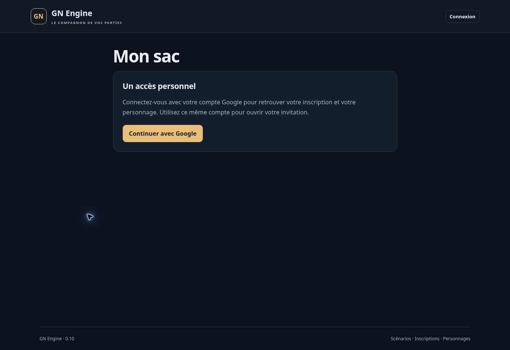

# Version 0.10 — remises gratuites entre joueurs

19 octobre 2026. Extension partielle de INV-01 à INV-04, ACT-01/03 et QR-02 du cahier V1. Aucun lot complet déclaré terminé. La version poursuit le catalogue, le sac et les soins de la 0.9.

## Parcours livré

1. Dans **Mon sac**, ouvrir un lot disponible et choisir **Remettre à un joueur**.
2. Coller le lien de son badge public et choisir une quantité entière. Le badge identifie un personnage de la même session ; il ne prouve pas sa présence.
3. Vérifier le nom des deux personnages, l’objet, sa version, la quantité et le stock qui resterait. Confirmer l’envoi d’une proposition gratuite.
4. Le destinataire actualise son sac et ouvre la proposition dans **Mes remises**. Il peut refuser ou accepter après avoir confirmé la remise matérielle prévue par les règles de jeu.
5. Après acceptation serveur, les objets apparaissent dans son sac. L’expéditeur peut annuler une proposition encore en attente. Refus et annulation ne consomment aucun objet.

Il s’agit d’un don : aucun prix, paiement, prêt, contrepartie ou échange simultané n’est engagé. Le destinataire devient propriétaire et détenteur de la quantité, située dans son sac. Aucune présence physique n’est certifiée par l’application.

## Proposition et confirmation

La préparation ne crée pas de proposition et n’écrit aucun stock. La proposition enregistrée ne réserve ni ne retire le matériel. Le lot reste utilisable ; une consommation, correction, saisie ou autre remise modifiant sa révision rend les propositions précédentes périmées. Elles apparaissent « À refaire ». Une nouvelle proposition exige une nouvelle vérification des quantités.

Le destinataire ne peut modifier l’objet, la quantité ou la cible en acceptant. Il doit être le titulaire courant du personnage visé, avec une inscription acceptée, un accès activé, une authentification assez récente et une fiche publiée. Les mêmes conditions sont relues pour l’expéditeur. Révocation, réattribution ou changement des identités liées à la proposition empêchent son acceptation. Une nouvelle invitation ne ressuscite pas l’ancien consentement.

La proposition et l’acceptation sont possibles uniquement en phase **En jeu**. La lecture reste permise pendant le briefing, la pause et la fin de partie ; refus et annulation restent possibles avec les droits courants. L’archive ferme les accès joueurs. Aucun délai d’expiration automatique n’est ajouté : l’expéditeur peut annuler et les données sont revérifiées à l’acceptation.

Avec le module PV activé, le hors combat bloque par défaut la remise et sa réception. Le réglage MJ **Remettre et recevoir des objets** permet explicitement cette action hors combat. Les deux parties doivent satisfaire la règle à l’acceptation. Le hors combat n’ouvre jamais le sac à un tiers.

## Conservation du stock

- **Lot entier** : le document existant change de propriétaire, détenteur et emplacement. Sa référence reste identique et sa révision augmente. Aucun deuxième exemplaire n’est créé.
- **Quantité partielle** : le lot source diminue ; un lot enfant distinct est créé dans le sac du destinataire, sans fusion avec un stock préexistant. Les quantités sont conservées. Le test HTTP vérifie notamment 20 unités devenant 12 chez l’expéditeur et 8 chez le destinataire.
- **Provenance** : le lot enfant conserve le modèle copié et les références du lot parent, de la racine et de la remise. Une remise entière conserve la provenance existante.
- **Exemplaire individuel** : quantité 1 ; pas de fractionnement d’un exemplaire. Les unités fractionnables des lots empilables sont des entiers, pas des volumes fractionnaires.

La transaction Firestore écrit ensemble le ou les lots, leurs historiques, la proposition acceptée, l’audit et le résultat de commande. Deux acceptations concurrentes du même stock ne réussissent pas toutes les deux. La compétition avec un soin ou une correction ne peut ni dupliquer le lot ni laisser un débit partiel. Acceptation et annulation concurrentes ont une seule issue.

La répétition de la même commande restitue son résultat sans refaire la remise. Le contrôle d’accès courant précède la restitution. Même si le destinataire remet ensuite le lot à un tiers, une répétition technique de l’acceptation d’origine ne le ramène pas dans son sac.

## Visibilité et suivi

Chaque joueur voit uniquement les propositions dont son personnage est expéditeur ou destinataire. La projection contient les identités publiques, l’objet et la quantité concernés, la référence et le statut. Elle n’inclut ni UID, empreinte d’accès, notes MJ, provenance interne ni solde du sac de l’autre partie.

Les propositions en attente restent visibles. La liste des opérations terminées est limitée aux 30 plus récentes. L’aperçu MJ utilise une projection sans boutons d’action. Les remises acceptées sont rattachées à l’historique des lots ; le journal de session conserve les propositions, acceptations, refus et annulations. Le rôle Accueil et les badges publics n’accèdent pas aux remises privées.

## Vérifications

- `npm test` : **172 tests réussis**, sans échec, après ajout de 16 parcours de remises et 4 tests d’interface.
- `npm run build` : interface compilée ; manifeste attendu 0.10.0.
- `npm run test:emulator` : **140 tests réussis**, sans échec, annulation ou test ignoré sur Auth et Firestore de `demo-gn-engine`, avec Java 21. Durée relevée : environ 157 secondes.
- Total local : **172 + 140 = 312 tests réussis**. Le même total est confirmé par les journaux GitHub sur le commit source.
- Les 16 parcours sont exécutés sur le store en mémoire et sur Firestore : préparation sans effet, consentement, intégrité de la cible, confidentialité, remise complète, division, historique, idempotence, compétition avec un soin, acceptations concurrentes, annulation concurrente, changement de stock, révocation/réattribution, hors combat, pause/fin, archive et panne synthétique avant commit.
- Le gestionnaire HTTP réel est testé avec des jetons Google synthétiques de l’émulateur Auth et Firestore : lot 20 → 12 + 8, accès refusés, répétition d’acceptation et révocation.
- GitHub, commit `d2f37aba7b6d9f82620d4f15f74f703c3e1d0503` : **172 + 140 = 312 tests réussis** sur Node 22, sans échec, annulation ou test ignoré. Le [workflow 39286991974](https://github.com/gkerckhofs-a11y/gn-engine/actions/runs/39286991974), job de vérification `118176480040`, compile à 16:38:11 UTC, termine les 172 tests à 16:38:15 UTC et les 140 intégrations à 16:41:01 UTC le 19 octobre 2026. Résultats tirés des journaux du job.
- Tous les comptes, objets et scénarios de test restent dans les émulateurs. Aucune donnée de test n’est créée en production.

## Limites et recette restante

- Pas de vente, monnaie, troc atomique, prêt, détention pour autrui, remise forcée ou validation MJ remplaçant le consentement.
- Pas de capacité de sac appliquée, entrepôt, contenant, quai, vaisseau, réservation d’emplacement ou transport. Le volume des objets reste descriptif.
- Pas de fractionnement autonome ni fusion ; seul un don partiel fractionne un lot empilable. Pas de QR d’objet physique, contenant vide ou unicité globale du modèle.
- Le lien du badge est saisi/collé. Aucun lecteur caméra intégré ni preuve automatique de présence. La réalité de la remise matérielle dépend des règles et de la confirmation du joueur.
- Actualisation manuelle des propositions ; aucune notification automatique ni expiration. Pas de réservation lors d’une proposition : même une modification laissant assez de stock oblige à la refaire.
- Requêtes non paginées sur les lots et propositions liés au personnage ; historique terminé limité dans la projection. Volumétrie et charge 60/120 joueurs non mesurées.
- Recette authentifiée sur plusieurs comptes Google réels, mobile et réseau terrain à réaliser. Les tests d’interface et les émulateurs ne la remplacent pas. Les lots A/B et INV-01 à INV-04 ne sont pas déclarés complètement validés.

## Publication

Le code applicatif publié est le commit `d2f37aba7b6d9f82620d4f15f74f703c3e1d0503`. Le [workflow Firebase 39286991974](https://github.com/gkerckhofs-a11y/gn-engine/actions/runs/39286991974), job de publication `118178610649`, consigne le 19 octobre 2026 :

- Fonction serveur `api` en Belgique : état **ACTIVE**, relevé à 16:42:48 UTC.
- Firebase Hosting : **Deploy complete** à 16:42:58 UTC.
- Contrôle final à **16:43:04 UTC** : page HTTP 200, manifeste exact **0.10.0**, puis **30 commandes privées refusées en HTTP 401 / LOGIN_REQUIRED** sans authentification.

Les tests et la publication sont confirmés par les journaux des jobs, même lorsque les métadonnées de statut renvoyées par le connecteur sont en retard. Aucun défaut de propagation du manifeste n’est observé dans ce contrôle final.

Le navigateur confirme ensuite **GN Engine · 0.10**. La route `#/bag/verification` affiche uniquement la connexion, sans stock ni proposition privée. Cette capture prouve la version visible et la fermeture de l’accès anonyme ; elle ne constitue pas une recette authentifiée des remises. Page finale : [GN Engine](https://gn-engine.web.app/).

Le workflow de publication exécute le contrôle HTTP après Firebase Hosting. Le workflow séparé `verify-live.yml` devient une relance manuelle en lecture seule : le lancer à chaque changement du script le ferait partir avant que la nouvelle version soit publiée. Les assertions restent strictes : version exacte 0.10.0 et 30 commandes privées refusées en HTTP 401 / LOGIN_REQUIRED sans authentification.
