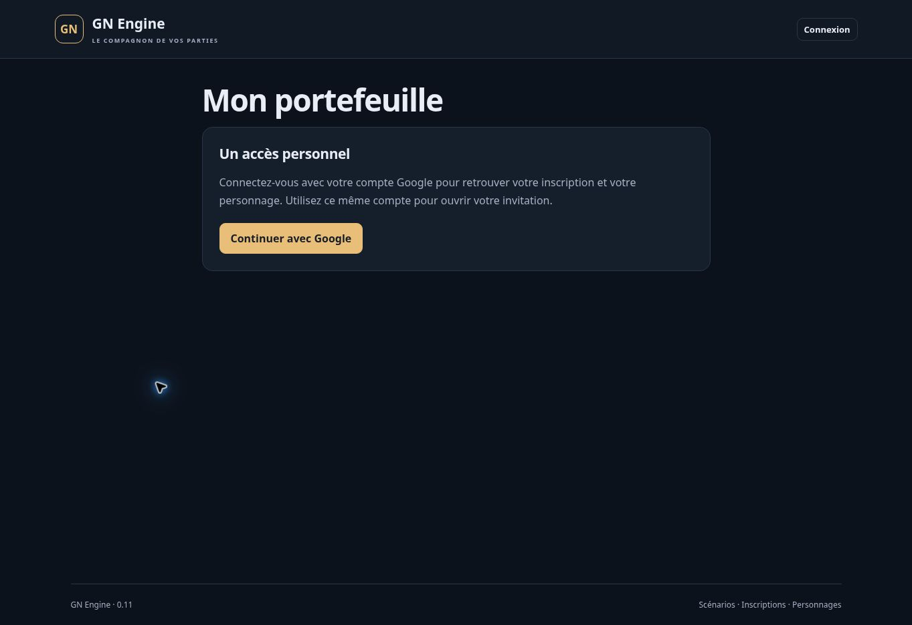

# Version 0.11 — portefeuilles et crédits de jeu

19 octobre 2026. Première intégration de ECO-01 à ECO-04 et extension des modèles versionnés EDI-03. Aucun lot complet déclaré terminé. La monnaie est fictive ; aucune opération financière réelle n’est engagée.

## Parcours livré

1. Dans le scénario, configurer explicitement le nom et l’unité entière de la monnaie, puis activer le module. Aucune monnaie ni valeur d’équilibrage Port-Brèche n’est inventée.
2. Pour chaque personnage, préparer les crédits de départ, vérifier l’avant/après et confirmer. Sans dotation, le compte commence à zéro. Une version figée conserve ces réglages ; chaque nouvelle session reçoit ses comptes indépendants.
3. Dans une session ancienne sans monnaie, configurer ouvre les portefeuilles manquants à zéro. Désactiver puis réactiver conserve comptes et soldes. Le nom et l’unité ne peuvent plus changer dans cette session.
4. Le joueur ouvre **Mon portefeuille**, consulte le total, le réservé, le disponible et ses 30 dernières écritures. Pendant le jeu, **Payer un personnage** demande le lien du badge public, un montant entier positif et un motif visible des deux parties et des MJ.
5. Le récapitulatif présente les identités, le montant, le motif et le solde/disponible du payeur avant/après. La confirmation applique immédiatement le débit et le crédit ensemble. Le bénéficiaire retrouve l’encaissement après actualisation ; son acceptation n’est pas requise pour recevoir des crédits.
6. Le MJ peut ajouter ou retirer un montant avec un libellé joueur et un motif privé. Une confirmation affiche les conséquences et crée une écriture supplémentaire. Les paiements antérieurs restent dans le journal.

Un paiement ne transfère aucun objet. Les remises gratuites de la 0.10 conservent leur propre proposition et acceptation. Les ventes avec transfert de propriété et paiement atomiques sont une étape distincte encore à développer.

## Soldes et journal

Un portefeuille personnel appartient au personnage dans sa session. Le nouveau titulaire autorisé reçoit son accès ; un changement de compte humain ne déplace pas l’argent vers un autre personnage. Les sessions ne partagent ni comptes ni soldes. Modifier une dotation ou une monnaie de scénario n’altère pas une session déjà créée.

Les montants sont des entiers sûrs positifs pour payer, ajouter ou retirer. Une dotation initiale peut valoir zéro. Les décimales, chaînes numériques, montants négatifs et dépassements numériques sont refusés. Le disponible vaut total moins réservé et ne peut devenir négatif. Ce parcours ne réserve aucun fonds ; un test synthétique vérifie néanmoins qu’une réservation existante est respectée par paiement et retrait MJ.

Le journal commun conserve référence, date, session par chemin de stockage, acteur, motif, parties et entrées avant/après. Un transfert a deux entrées de signes opposés et ne crée ni ne retire de monnaie. Dotations et corrections indiquent la monnaie créée ou retirée. Chaque compte possède son historique, avec le même identifiant d’opération, permettant de reconstituer son solde à partir de zéro. Les écritures restent stockées ; l’interface n’en affiche que les 30 dernières par compte.

## Confirmation et concurrence

La préparation ne modifie aucun compte. La confirmation relit droits, phase, règles et comptes. Un solde du payeur modifié, un autre motif, un changement d’accès ou d’identité du bénéficiaire rendent l’ancien récapitulatif inutilisable. Un encaissement du bénéficiaire ne périme pas le paiement : sa révision est contrôlée transactionnellement, mais son solde ne figure pas dans le récapitulatif du payeur.

Débit, crédit, journal, historiques, audit et résultat sont écrits dans une même transaction Firestore. Deux paiements de 80 sur 100 ont un seul gagnant. Deux payeurs peuvent créditer concurremment le même bénéficiaire sans perdre l’un des crédits. Une correction MJ préparée avant un paiement ne peut écraser son résultat. Un échec avant commit ne laisse aucune écriture partielle.

Une répétition avec le même identifiant et les mêmes paramètres restitue le résultat enregistré sans repayer. Le même identifiant avec un montant ou motif différent est refusé. L’accès actuel est vérifié avant restitution ; une nouvelle invitation ne réactive pas l’ancien consentement. Après réussite, un réessai technique en pause peut restituer le résultat, sans nouveau mouvement.

## Droits et confidentialité

La source est toujours le compte du personnage attribué au compte Google vérifié, avec inscription acceptée, accès activé, authentification assez récente et fiche publiée. Un `characterId` ou compte source forgé ne permet pas de payer depuis un autre portefeuille. Le bénéficiaire doit être distinct, publié, attribué et actif dans la même session. Le badge ne donne aucun accès privé.

La lecture est permise au briefing, pendant le jeu, en pause et après la fin. Un nouveau paiement exige **En jeu**. L’archive et le module désactivé ferment l’accès joueur. Le hors combat bloque par défaut le payeur ; le MJ peut autoriser explicitement **Effectuer un paiement**. Recevoir un crédit reste passif, même hors combat.

Le joueur voit uniquement son propre solde, ses entrées et l’identité publique de sa contrepartie. Ni solde adverse, UID d’acteur, motif MJ ni notes privées ne sont transmis. Les motifs de paiement sont visibles des deux parties et des MJ, comme indiqué dans le formulaire. Le rôle Accueil n’obtient aucun compte. Le MJ dispose d’un aperçu sans action et d’un historique contenant les motifs privés. Révoquer sa délégation bloque également les réessais d’une correction déjà réussie.

## Vérifications

- `npm test` : **196 tests réussis**, sans échec, annulation ou test ignoré (20 nouveaux parcours métier et 4 tests d’interface).
- `npm run build` : interface compilée et manifeste exact 0.11.0 généré.
- Les 20 parcours métier sont partagés entre le store mémoire et Firestore émulé : dotations, indépendance, activation, confidentialité, atomicité, journal, réessais, concurrence, droits, révocation/réattribution, hors combat, pause/fin/archive, corrections, réservations et panne avant commit.
- Le gestionnaire HTTP réel est couvert avec des assertions Google synthétiques de l’émulateur Auth : dotation 100, paiement 80, soldes 20/80, répétition unique, identité source imposée par serveur, droits MJ, 11 nouvelles commandes refusées sans authentification et révocation immédiate.
- `npm run test:emulator` : **161 tests réussis** sur Auth et Firestore de `demo-gn-engine`, avec Java 21, en environ 172 secondes. Aucun échec, annulation ou test ignoré.
- Total local : **196 + 161 = 357 tests réussis**. Le même total est confirmé dans les journaux GitHub sur Node 22.23.3.
- GitHub, commit source `00b743473db95402ef36ce9d73cdb9ddb1b00af9` : [workflow 39290688332](https://github.com/gkerckhofs-a11y/gn-engine/actions/runs/39290688332), job `118190238589`. Compilation réussie à 17:02:52 UTC ; 196 tests à 17:02:56 UTC et 161 intégrations à 17:05:58 UTC le 19 octobre 2026. Aucun échec, annulation ou test ignoré. Résultats tirés du journal terminé.
- Toutes les données de test sont synthétiques et restent dans `demo-gn-engine`. Aucune donnée de test n’est chargée dans Firebase de production.

## Limites et recette restante

- Comptes personnels uniquement. Caisses de groupes/établissements, habilitations multiples, prêts, salaires programmés, impôts, contrats et devises multiples restent à développer.
- Pas de vente, prix, séquestre, réservation commerciale ou échange atomique entre objet et monnaie. Les soldes réservés sont respectés, mais aucun parcours de réservation n’est livré.
- Pas d’annulation liée à une opération ni analyse des écritures dépendantes. Une correction MJ est une nouvelle écriture motivée ; elle ne prétend pas annuler un paiement.
- Dotations individuelles, sans valeurs initiales héritées des classes. Aucun équilibrage Port-Brèche fourni implicitement.
- Historique affiché limité à 30 entrées, sans pagination ni export. Les comptes de la session sont chargés ensemble pour le MJ. Volumétrie, copies de grandes sessions et charge 60/120 joueurs non mesurées.
- Badge saisi/collé, sans caméra intégrée ni preuve de présence. Aucun reçu automatiquement envoyé ni notification d’encaissement ; actualisation manuelle.
- Aucun paiement hors ligne. Le client garde la référence de réessai pendant la page active ; après fermeture/rechargement, consulter le journal pour vérifier une opération dont le résultat réseau était incertain. Pas de file persistante de commandes livrée.
- Recette authentifiée sur plusieurs comptes Google réels, mobile et réseau terrain à réaliser. Les tests d’interface et émulateurs ne la remplacent pas. Les lots A/B/C et ECO-01 à ECO-04 ne sont pas déclarés complètement validés.

## Publication

Le code applicatif publié est le commit `00b743473db95402ef36ce9d73cdb9ddb1b00af9`. Le [workflow Firebase 39290688332](https://github.com/gkerckhofs-a11y/gn-engine/actions/runs/39290688332), job de publication `118192098418`, consigne le 19 octobre 2026 :

- Fonction serveur `api` en Belgique : état **ACTIVE** à 17:07:46 UTC.
- Firebase Hosting : **Deploy complete** à 17:07:55 UTC.
- Contrôle final à **17:08:02 UTC** : page HTTP 200, manifeste exact **0.11.0**, puis **41 commandes privées refusées en HTTP 401 / LOGIN_REQUIRED** sans authentification.

Résultats observés dans les journaux terminés. Le navigateur confirme ensuite **GN Engine · 0.11**. La route `#/wallet/verification` affiche uniquement la connexion, sans solde ni historique privé. Cette capture prouve la version visible et la fermeture de l’accès anonyme ; elle ne constitue pas une recette authentifiée des paiements. Page finale : [GN Engine](https://gn-engine.web.app/).

