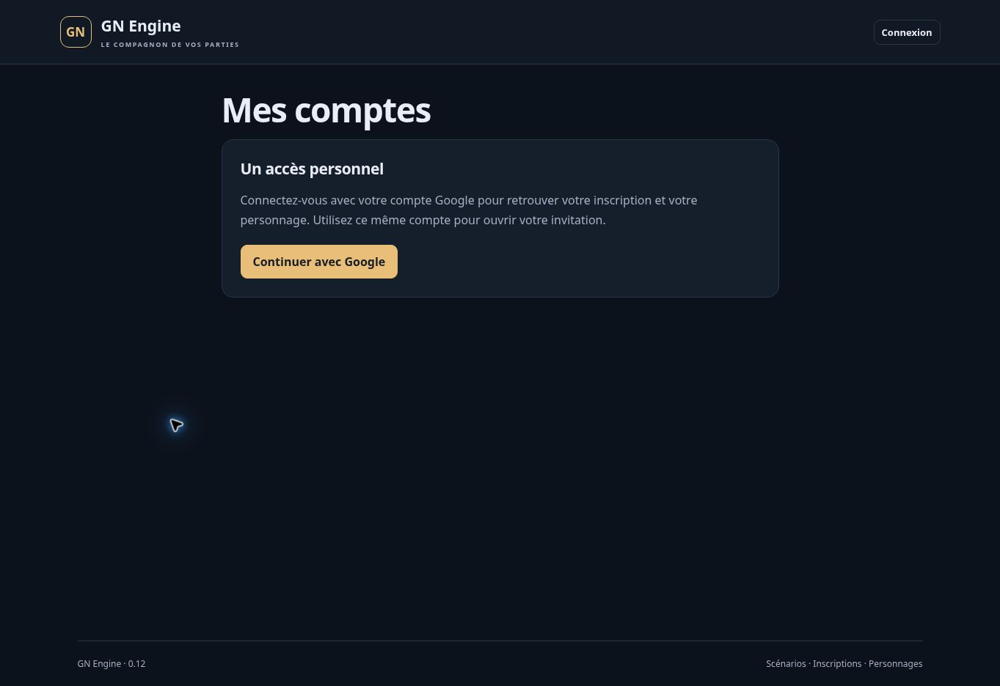

# Version 0.12 — caisses collectives et droits de paiement

19 octobre 2026. Extension partielle de SES-02, ECO-01 à ECO-04 et EDI-03 du cahier V1. Aucun lot complet déclaré terminé. Les comptes manipulent uniquement des crédits fictifs.

## Configuration et parcours

1. Configurer la monnaie du scénario, créer un groupe, puis ouvrir **Caisses des groupes**. Préparer un libellé de paiement et une dotation entière, vérifier le récapitulatif et confirmer.
2. Dans les appartenances du groupe, choisir séparément **Consulter la caisse** et **Payer avec la caisse**. Les droits sont désactivés par défaut. Le personnage doit avoir une appartenance active et révélée, et le groupe doit être publié.
3. Figer une version du scénario et créer une session : chaque caisse reçoit son compte et sa dotation propres. Modifier ensuite le scénario ne change pas les comptes existants.
4. Dans une session ancienne, préparer puis confirmer une caisse ouvre un compte à zéro. Un ajout de fonds passe ensuite par une correction MJ confirmée et motivée. Renommer une caisse conserve son solde, ses réservations et son journal.
5. Le joueur ouvre **Mes comptes et caisses** depuis son portefeuille, ou **Caisse du groupe** depuis l’espace du groupe. La liste contient son compte personnel et les seules caisses qu’il peut consulter ou utiliser pour payer.
6. Depuis le compte choisi, préparer un paiement vers un personnage actif identifié par son badge ou vers un autre compte de sa propre liste autorisée. Vérifier compte débité, bénéficiaire, montant et motif, puis confirmer.

Un établissement peut être représenté par un groupe avec ses membres et permissions. Aucune entité métier distincte « établissement » ni annuaire public des comptes n’est livré. Un paiement vers la caisse d’un groupe extérieur, sans accès à cette caisse, reste à intégrer. Les ventes et les réservations commerciales ne font pas partie de cette version.

## Droits indépendants

| Consulter | Payer | Résultat applicatif |
|---|---|---|
| Non | Non | Caisse absente de la liste ; accès direct refusé |
| Oui | Non | Solde total/réservé/disponible et 30 dernières écritures ; débit refusé |
| Non | Oui | Libellé et formulaire de paiement ; aucun champ de solde ni historique transmis |
| Oui | Oui | Consultation et paiement, selon phase de jeu et règles hors combat |

Un membre pouvant consulter une caisse peut y verser des crédits depuis son compte personnel, même sans droit de la débiter. Un caissier peut payer son propre personnage depuis la caisse : il s’agit d’un transfert entre deux comptes distincts autorisé par son droit de dépense. Aucun transfert d’un compte vers lui-même n’est accepté.

Le droit de paiement autorise à proposer des montants et à recevoir leur acceptation ou leur refus, notamment pour fonds insuffisants. L’absence de droit de consultation retire les champs et le journal ; elle ne garantit pas qu’aucune borne du solde ne puisse être déduite de ces réponses.

Les droits et l’accès au personnage sont relus avant toute commande, y compris avant de restituer un résultat mémorisé. Retirer le droit de dépense interdit le réessai d’un paiement déjà réussi. Retirer le droit de consultation empêche de récupérer un ancien résultat contenant le solde. Rétablir ensuite les droits ne réactive pas les anciennes confirmations : les révisions de groupe ont changé.

Une exclusion, une appartenance non révélée, un groupe dépublié, une révocation, une authentification trop ancienne ou une attribution remplacée ferme l’accès concerné. La caisse reste attachée au groupe de la session, et ses droits au personnage membre. Le compte humain remplaçant un personnage reçoit ses droits actuels, sans créer ni déplacer de fonds.

L’économie doit être activée ; les caisses exigent aussi l’activation des groupes. Désactiver les groupes conserve les comptes, tout en fermant les accès joueurs à leurs caisses. La lecture reste possible au briefing, en jeu, en pause et à la fin, selon les droits ; un nouveau paiement exige En jeu. L’archive ferme les accès joueurs. Le hors combat applique la permission de paiement existante au caissier, sans immobiliser la réception passive des fonds.

## Groupes secrets et visibilité

Le MJ renseigne explicitement un **libellé visible par les contreparties**. Un groupe secret peut utiliser un nom de couverture. Le formulaire prévient que ce libellé figurera dans les récapitulatifs et journaux des personnes payées ; aucun alias n’est inventé par défaut.

Un paiement collectif transmet ce libellé, la référence du compte et le motif, sans transmettre le nom interne du groupe, son identifiant de groupe, ses membres, le personnage caissier, son UID ou les notes MJ. La référence du compte ne permet pas d’ouvrir celui-ci sans permission. Le nom d’un compte personnel reste l’identité publique de son personnage. Un motif peut librement contenir du texte : le rédacteur doit choisir ce qu’il révèle aux titulaires autorisés des deux comptes.

Le journal technique MJ conserve l’UID de l’auteur et le personnage caissier pour l’audit. Le joueur autorisé à consulter la caisse voit ses entrées, son propre solde et les libellés de contrepartie, sans leur solde ni motif MJ. Les badges publics et le rôle Accueil ne reçoivent aucune caisse. L’aperçu MJ applique les droits du personnage choisi et ne propose aucun bouton de paiement.

Renommer le libellé ne réécrit pas les paiements passés : leur journal conserve celui qui avait été confirmé à l’époque. Toute modification de groupe ou de configuration rend une ancienne préparation de paiement périmée, même si le solde n’a pas changé.

## Intégrité des comptes

Les caisses partagent le journal et les règles de montants entiers sûrs des portefeuilles personnels. Réservations existantes, fonds insuffisants, dépassements numériques et corrections périmées restent contrôlés. Aucun découvert ni nouveau parcours de réservation n’est ajouté.

Débit, crédit, deux historiques de compte, journal commun, audit et résultat idempotent sont appliqués dans la même transaction Firestore. Deux caissiers demandant chacun 80 sur une caisse de 100 ne réussissent pas tous les deux. Deux encaissements concurrents sont conservés. Un échec avant commit ne laisse ni débit, ni crédit, ni historique partiel.

La préparation ne crée aucun mouvement. Le récapitulatif inclut les soldes avant/après uniquement si le payeur dispose du droit de consultation. Pour un caissier sans ce droit, la confirmation est liée à la révision du compte sans encoder son solde caché dans l’empreinte. Un changement de solde impose une nouvelle préparation. Les encaissements du bénéficiaire ne périment pas le paiement préparé ; leur révision est contrôlée dans la transaction.

Les ajouts et retraits MJ utilisent le même parcours confirmé que les comptes personnels, avec libellé joueur et motif privé. Les écritures précédentes sont conservées. Le journal intégral reste stocké ; l’interface présente les 30 dernières écritures par compte.

## Vérifications

- `npm test` : **220 tests réussis**, sans échec, annulation ou test ignoré. Ajout de 20 parcours métier partagés et 4 tests d’interface.
- `npm run build` : compilation réussie ; manifeste **0.12.0** généré.
- Les 20 parcours sont exécutés sur le store mémoire et sur Firestore émulé : droits indépendants, groupes secrets, concurrence de caissiers et d’encaissements, réessais, retraits de permissions, publication, libellés, copies figées, ouverture à zéro, transferts entre comptes, accès croisés, révocation, réattribution, corrections, réservations, modules, hors combat, archive et panne avant commit.
- Le gestionnaire HTTP réel est testé avec Auth émulé : lecteur refusé pour payer, caissier sans accès au solde, dotation 100, paiement 80 unique, solde final 20 et réception 80, alias sans nom de groupe secret, retrait de permission et 7 nouvelles commandes fermées sans connexion.
- `npm run test:emulator` : **182 tests réussis**, sans échec, annulation ou test ignoré, avec Java 21, en environ 199 secondes.
- Total local : **220 + 182 = 402 tests réussis**. Le même total est confirmé dans les journaux GitHub sur Node 22.23.3.
- GitHub, commit source `0643543ad612e620af4eb0f3fc779b17b9ccd313` : [workflow 39296121140](https://github.com/gkerckhofs-a11y/gn-engine/actions/runs/39296121140), job `118208982002`. Compilation réussie à 17:40:49 UTC ; 220 tests à 17:40:54 UTC et 182 intégrations à 17:44:30 UTC le 19 octobre 2026. Aucun échec, annulation ou test ignoré. Résultats lus dans le journal terminé.
- Données et comptes de test synthétiques dans `demo-gn-engine` uniquement. Aucune donnée de test créée dans Firebase de production.

## Limites et recette restante

- Une caisse par groupe. Pas de délégation financière à un non-membre, plafond individuel, double signature, sous-comptes ou comptabilité dédiée à une entité établissement.
- Cible collective limitée aux comptes de la liste autorisée du payeur. Aucun QR public de caisse, annuaire bancaire ou alias de paiement publiquement résolvable.
- Pas de vente, transfert de propriété lié au paiement, contrat, salaire automatique, taxe ou réservation commerciale. Un paiement ne déplace aucun objet.
- Pas d’annulation avec analyse des dépendances : la correction MJ ajoute une écriture, sans prétendre annuler une chaîne d’opérations.
- Un nouvel accès de consultation donne les 30 dernières écritures disponibles de la caisse ; aucune segmentation de l’historique par date d’arrivée du membre.
- Listes de groupes/comptes non paginées, historique affiché limité à 30 et actualisation manuelle. La charge à 60/120 joueurs et les limites des grosses copies de scénarios restent à mesurer.
- Pas de paiement hors ligne, notification automatique ni lecteur caméra. Après une réponse réseau incertaine, conserver le réessai de la page active ou vérifier le journal, ou demander une vérification MJ sans droit de consultation, avant une nouvelle opération ; une fermeture de page ne conserve pas une file de commandes.
- Recette avec comptes Google réels distincts, mobile et réseau terrain encore nécessaire. Les émulateurs et tests de rendu ne la remplacent pas. Aucun lot A/B/C ni exigence économique complète déclaré validé.

## Publication

Le code applicatif publié est le commit `0643543ad612e620af4eb0f3fc779b17b9ccd313`. Le [workflow Firebase 39296121140](https://github.com/gkerckhofs-a11y/gn-engine/actions/runs/39296121140), job de publication `118211038519`, consigne le 19 octobre 2026 :

- Fonction serveur `api` en Belgique : état **ACTIVE** à 17:46:07 UTC.
- Firebase Hosting : **Deploy complete** à 17:46:16 UTC.
- Contrôle final à **17:46:24 UTC** : page HTTP 200, manifeste exact **0.12.0**, puis **48 commandes privées refusées en HTTP 401 / LOGIN_REQUIRED** sans authentification.

Les résultats sont observés dans les journaux terminés. Le navigateur confirme ensuite **GN Engine · 0.12**. La route `#/accounts/verification` affiche uniquement la connexion, sans nom de caisse ni solde ni historique privé. Cette capture prouve la version visible et la fermeture de l’accès anonyme ; elle ne constitue pas une recette authentifiée des caisses. Page finale : [GN Engine](https://gn-engine.web.app/).

