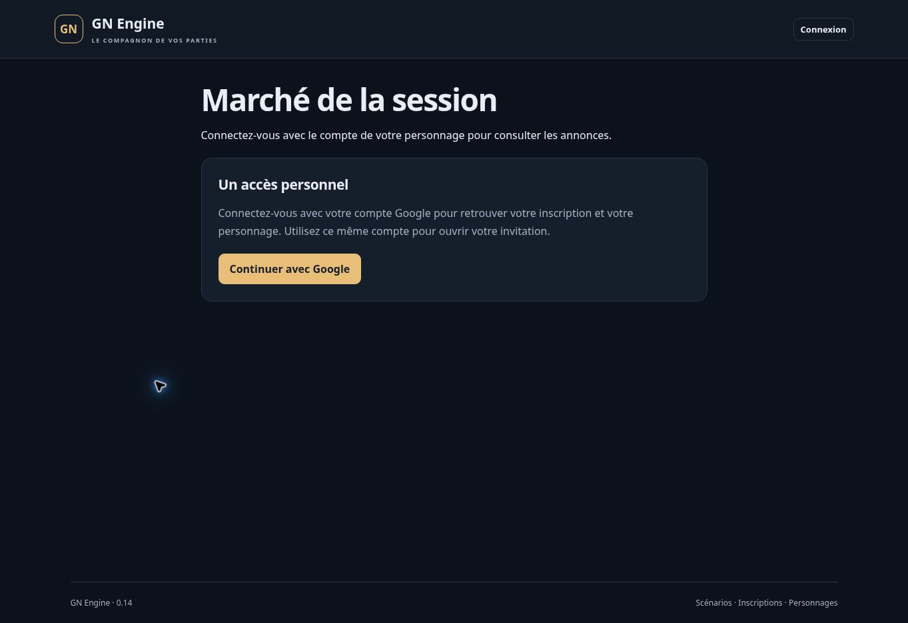

# Version 0.14 — marché de session et stock réservé

19 octobre 2026. Extension partielle de MAR-01/02/03/05 et des parcours d’inventaire et de paiement. Aucun lot complet déclaré terminé. Les prix, quantités, durées et lieux sont saisis explicitement ; aucun tarif canonique n’est inventé.

## Parcours livré

1. Dans **Mon sac**, ouvrir un lot disponible puis **Publier au marché**. Le vendeur doit en être propriétaire et détenteur, avec l’objet dans son sac.
2. Saisir une quantité entière, un **prix total pour toute cette quantité**, une durée de 1 à 10 080 minutes réelles, le lieu de retrait et les conditions. Vérifier puis confirmer la publication.
3. Le marché est visible aux personnages publiés dont l’accès à cette session est actif. Il affiche l’objet, sa description et sa catégorie, le vendeur, la quantité, le prix, les frais nuls, le lieu, les conditions et l’échéance. Recherche par objet, vendeur ou lieu ; filtre de catégorie et **Mes annonces**.
4. L’acheteur choisit son portefeuille personnel ou une caisse autorisée. Le récapitulatif confirme le prix fixé, le compte, le bénéficiaire, les frais nuls, les conditions et la séparation entre propriété et remise physique.
5. L’achat débite et crédite les comptes, transfère la propriété, ferme l’annonce et écrit les journaux dans une transaction unique. Une annonce est achetée entièrement, une seule fois.
6. L’acheteur rejoint **Mon sac** et retrouve son objet à récupérer. Vendeur et acheteur suivent le parcours de retrait 0.13, sans second paiement.
7. Le vendeur peut retirer une annonce invendue après confirmation. Le MJ dispose de **Gérer le marché** dans les inventaires de session, avec retrait motivé ; le rôle Accueil en est exclu.

Ce marché est interne à la session authentifiée. Une annonce n’est pas publiée sur Internet sans connexion. Le vendeur utilise son identité publique de personnage ; les alias commerciaux et audiences limitées à des groupes ne sont pas encore implémentés.

## Réservation et expiration

La publication réserve immédiatement le stock. Pour une quantité partielle, le lot est scindé : la quantité annoncée est réservée dans un lot distinct, le reste demeure disponible. Un exemplaire individuel est indivisible. La filiation et la quantité totale sont conservées.

Un lot réservé ne peut être annoncé une seconde fois, donné, vendu en privé, consommé par un soin ou corrigé par le MJ. Le MJ doit d’abord retirer l’annonce. Les propositions privées et remises gratuites restent sans réservation avant acceptation, mais une réservation ultérieure invalide leurs anciens consentements.

L’expiration utilise le temps serveur réel, y compris pendant une pause. À l’échéance, toute lecture et commande de stock voit le lot disponible, sans tâche planifiée ni action utilisateur de nettoyage. Une révision supplémentaire invalide les anciennes confirmations ; le prochain changement de stock persiste l’état libéré. Le document brut peut donc conserver temporairement `RESERVED`, mais les services métier appliquent tous la même interprétation de l’échéance. L’historique de réservation conserve la date de libération prévue ; aucune fausse opération de nettoyage n’est journalisée à chaque lecture.

Retirer une ancienne annonce expirée ne libère jamais un lot réservé depuis par une nouvelle annonce. Une annonce vendue ne peut être retirée. Aucun fonds n’est réservé à la publication ou à la préparation d’achat ; seuls les fonds disponibles peuvent être débités au paiement. L’objet déjà payé n’expire pas.

## Droits, confidentialité et cohérence

Publication et achat exigent **En jeu**, économie activée et permissions hors combat adéquates. Consultation et retrait restent possibles en pause ou fin de partie, et le retrait reste possible après désactivation de l’économie. Une archive ferme ces accès.

Une révocation ou réattribution du vendeur rend l’annonce indisponible aux autres joueurs. Son stock reste réservé jusqu’à l’échéance ou au retrait par le MJ ; une nouvelle activation ne ressuscite pas l’ancien consentement. Un joueur ayant l’accès courant au personnage peut retirer l’ancienne annonce et en préparer une nouvelle.

Le marché ne transmet ni UID, notes MJ, inventaire complet, historique financier, compte payeur ou identité de l’acheteur aux tiers. Les annonces fermées sont accessibles à leur vendeur et au MJ ; l’acheteur retrouve son reçu dans les ventes privées de son sac. Les droits de dépense collectifs sont contrôlés avant la préparation, l’achat et un résultat de réessai. Une caisse sans droit de lecture ne révèle aucun solde. Le vendeur reçoit son libellé commercial, pas le nom interne du groupe secret. Le personnage acheteur reste propriétaire même si une caisse paie.

Le prix, la description copiée, la quantité et les conditions de l’annonce sont figés. Les changements du catalogue n’altèrent pas les lots existants. Le serveur ignore les prix/quantités forgés à l’achat et refuse une confirmation périmée. Publication, réservation, achat, paiement, propriété, écritures et résultats idempotents sont atomiques. Deux acheteurs ou deux publications sur le même stock ne peuvent réussir ensemble. Les propositions de retrait physique, corrections et réessais gardent les contrôles de la 0.13.

## Vérifications

- Compilation locale réussie ; `npm test` : **271 tests réussis**, aucun échec, annulation ou test ignoré.
- 23 nouveaux parcours métier exécutés sur le stockage mémoire puis partagés avec Firestore : réservation entière/partielle, expiration, réutilisation, dons/soins/ventes bloqués, correction MJ, concurrence, paiement collectif, droits, confidentialité, rollback, identité, prix fixé et retrait sans second paiement.
- 4 tests d’interface : champs et confirmation, filtres, comptes autorisés et solde masqué, retrait motivé et aperçu sans action.
- Un nouveau parcours HTTP avec Auth/Firestore émulés : annonce de 8 caisses sur un stock de 20, prix 40, réservation, confirmation altérée refusée, accès tiers refusés, achat unique et révocation prioritaire.
- `npm run test:emulator` : **227 tests réussis**, aucun échec, annulation ou test ignoré, en environ 263 secondes avec Java 21. Total local : **271 + 227 = 498**. Le job GitHub `118252281350`, commit source `d7d0fd71cc01cb96df7f1186df639f0b823c6bd1`, confirme **271 + 227 = 498 tests réussis**, sans échec, annulation ou test ignoré. Node 22.23.3 ; compilation terminée le 19 octobre 2026 à **19:10:28 UTC**, tests métier/interface à **19:10:35 UTC**, intégrations à **19:15:42 UTC**. Résultats lus dans le journal terminé.
- Données synthétiques exclusivement dans `demo-gn-engine` ; aucune donnée de test créée en production.

## Limites et recette restante

Pas d’achat partiel d’une annonce, panier, négociation, contre-offre, services, vendeur extérieur, alias vendeur, annonces réservées à un contact/groupe, marché noir configurable, frais/taxes, séquestre, contrats, remboursement automatique ou litige formalisé. Les annonces de missions/recrutement ANN-01 à ANN-06 restent distinctes et à réaliser.

Le lieu saisi est un rendez-vous narratif ; il ne crée ni entrepôt ni autorisation d’accès. Propriété collective, transport, capacités, équipement, fusion et QR physique restent à intégrer. La réception déclarée n’est pas une preuve technique de présence.

Actualisation manuelle et listes sans pagination : annonces actives, anciennes annonces propres encore brutes actives et 30 dernières annonces propres fermées ; le MJ consulte l’ensemble. Le volume et les coûts de lecture restent à mesurer pour 60/120 joueurs. Les réessais sont conservés dans la page active, pas dans une file hors ligne persistante.

La recette avec comptes Google réels distincts, téléphones et réseau terrain reste à effectuer. Les émulateurs et tests de rendu ne la remplacent pas.

## Publication

Le code applicatif publié est le commit `d7d0fd71cc01cb96df7f1186df639f0b823c6bd1`. Le [workflow Firebase 39308672976](https://github.com/gkerckhofs-a11y/gn-engine/actions/runs/39308672976) termine avec succès pour la vérification `118252281350` et la publication `118255078012`. Le journal de publication consigne le 19 octobre 2026 :

- Fonction serveur `api` en Belgique : **ACTIVE** à **19:17:21 UTC**.
- Firebase Hosting : **Deploy complete** à **19:17:53 UTC**.
- Contrôle final à **19:18:06 UTC** : page HTTP 200, manifeste exact **0.14.0** et **66 commandes privées refusées en HTTP 401 / LOGIN_REQUIRED** sans authentification, dont les neuf commandes du marché.

Le navigateur confirme **GN Engine · 0.14**. La route `#/market/verification` affiche seulement la connexion, sans annonce, prix ou identité privée. La capture prouve la version affichée et la fermeture de l’accès anonyme ; elle ne constitue pas une recette authentifiée des achats. Page finale : [GN Engine](https://gn-engine.web.app/).

