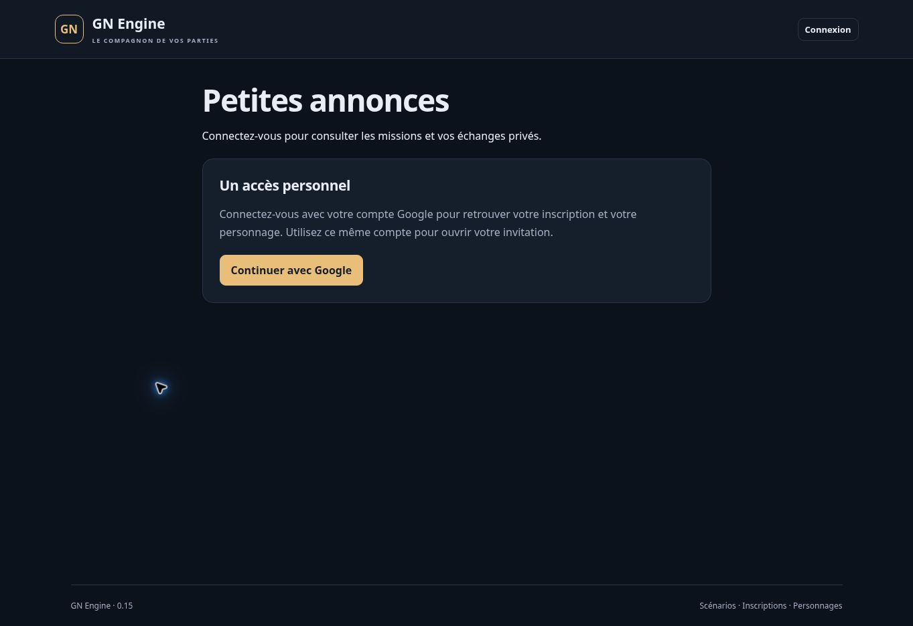

# Version 0.15 — petites annonces et candidatures privées

19 octobre 2026. Extension partielle de ANN-01/02/03/04/06 du cahier V1. ANN-05 et REC-10 ne sont pas validés : attribution contractuelle, acceptation bilatérale, déblocage de briefing, preuve et paiement restent à réaliser. Aucun lot complet déclaré terminé.

## Parcours livré

Depuis la régie de session, **Gérer les petites annonces** ouvre le tableau des missions et des réponses. Le propriétaire ou un MJ crée une annonce, la prévisualise puis confirme son enregistrement avec motif. Le rôle Accueil et les joueurs ne peuvent pas administrer ce tableau.

L’annonce précise titre, catégorie (prime, mercenaires, escorte, transport, information, autre service), mode (mission avec sélection ou prime ouverte sans exclusivité), commanditaire de fiction et nom/alias visible, description, récompense fixe ou négociable, places/récompenses prévues, conditions, preuve attendue, ouverture et échéance. Le commanditaire est un libellé de fiction explicite ; ce libellé n’accorde aucun droit technique à un personnage ou groupe.

La récompense et le tarif proposé sont des textes avec unité ou contrepartie précisée par l’auteur. Aucun montant canonique ni règle d’équilibrage n’est créé. Ce texte n’est pas une opération financière : il ne crée ni solde, ni réservation, ni contrat, ni paiement. Le nombre de places décrit l’objectif de recrutement ; aucun candidat n’est encore attribué et aucun quota de prime n’est réglé.

Les annonces peuvent être brouillons, programmées, ouvertes, clôturées, expirées ou annulées. La programmation et l’expiration sont évaluées sur l’heure serveur réelle, sans tâche planifiée ; le délai continue pendant une pause. Le formulaire saisit les dates dans le fuseau du navigateur et les transmet en instants absolus. Un brouillon ou une annonce future reste inaccessible au joueur, y compris par son identifiant direct. L’échéance ferme les nouvelles réponses.

Le joueur ouvre **Petites annonces** depuis son personnage ou le marché des objets. Recherche par mission, texte ou commanditaire et filtre de catégorie portent sur les seules annonces ouvertes auxquelles il a accès. **Mes candidatures et échanges** affiche séparément ses questions et candidatures, leur statut et l’état actuel de l’annonce.

## Audiences et informations réservées

L’organisateur choisit tous les joueurs actifs, ou une union de personnages et groupes sélectionnés. L’accès par groupe exige l’activation du module de groupes, un groupe publié et une appartenance active révélée au personnage. Le joueur ne reçoit ni la liste des destinataires ni les noms/identifiants des groupes qui justifient son accès. Les lecteurs restent soumis à leur inscription acceptée, leur personnage publié et leur invitation active.

Le texte public, le briefing réservé et les notes MJ sont enregistrés séparément. **Le briefing réservé reste entièrement côté MJ dans cette version** : une candidature ne le débloque pas. Notes, briefing, auteur technique, UID et règles d’audience ne figurent jamais dans les projections joueur. L’historique MJ conserve les versions complètes, les motifs et l’auteur technique.

Les permissions sont revérifiées lors de chaque lecture, préparation, écriture et avant un résultat de réessai concerné. Une exclusion du groupe, une modification d’audience ou une remise en brouillon ferme aussi l’accès aux échanges liés. La désactivation des groupes supprime l’accès issu d’un groupe ; une autorisation directe au personnage demeure valable. Ces restrictions portent sur les prochaines lectures, pas sur un texte déjà vu à l’écran.

## Candidatures et échanges

Le joueur pose une question ou candidate personnellement avec un message. Une annonce négociable autorise un tarif proposé privé. Un récapitulatif indique le texte, le nom du candidat, l’annonce et ses conditions avant l’envoi. Une question peut évoluer en candidature dans le même échange. Les réponses pour un groupe et les représentants non-MJ du commanditaire restent à développer.

Le candidat et les organisateurs habilités lisent l’échange ; les concurrents n’en reçoivent ni le contenu, ni le tarif, ni le nombre de réponses. L’organisateur répond après vérification du destinataire et du texte, sous le nom/alias visible du commanditaire. L’auteur technique reste dans le stockage et l’audit MJ. Les statuts sont **envoyée, en discussion, refusée, retirée**. Refus et retrait sont terminaux pour cet échange et cette identité d’accès. Aucune sélection n’est présentée comme une attribution ou un contrat.

Les réponses et modifications de l’annonce apparaissent dans **Infos**, sous **Réponses aux petites annonces**, avec un indicateur de nouveauté et un lien vers l’échange privé. Le joueur marque explicitement la version de l’échange et de l’annonce comme lues. Une confirmation de lecture périmée ne masque pas un message plus récent. Il n’y a ni courriel, ni notification push, ni actualisation automatique.

L’échange est lié au compte authentifié, au personnage et à sa version d’identité d’accès, qui comprend son nom public. Révocation, nouvelle activation, réattribution ou changement de nom ne permettent pas de réutiliser un ancien consentement. Le successeur d’un personnage n’accède pas aux échanges du précédent occupant. Une nouvelle identité doit ouvrir un nouvel échange ; l’ancien reste consultable par le MJ, sans possibilité de lui répondre tant que l’identité/audience initiale n’est plus courante.

La première annonce vue est conservée dans l’échange. La dernière version relue lors d’une réponse est également conservée ; les messages indiquent la version concernée. Modifier l’annonce invalide une réponse préparée avant ce changement. Cela ne transforme pas une candidature en accord contractuel.

Les réponses joueur exigent **En jeu** et la permission de publication selon les règles hors combat. La consultation est possible en briefing, pause et fin de partie. Le retrait reste possible en pause ou fin de partie. Les organisateurs peuvent répondre ou refuser après l’échéance à un candidat qui conserve son accès, pour clore l’échange. Une archive ferme les accès de ce module.

## Cohérence

Publication, historique, audit et résultat idempotent sont écrits atomiquement. Message, version d’échange, statut, état de lecture, audit et résultat sont également écrits ensemble. Les lectures précèdent les écritures dans les transactions Firestore.

Un même envoi rejoué renvoie son résultat sans second message. Deux confirmations préparées sur la même version ne peuvent pas écraser leurs messages. Un retrait concurrent et une réponse ne perdent ni le statut ni le contenu. Deux candidats distincts peuvent répondre à la même offre avec des tarifs privés : cela ne réserve aucune place, aucun stock et aucun fonds. Une interruption avant commit ne laisse pas d’annonce ou message partiel.

## Vérifications

- `npm test` : **299 tests réussis**, aucun échec, annulation ou test ignoré.
- 24 nouveaux parcours métier partagés avec Firestore : prévisualisation, programmation, échéance, audiences directes/groupes secrets, révocation, réattribution, tarifs privés, concurrence, réessais, historique, lecture, hors combat, phases, refus/retrait, panne et accès anonymes.
- 4 nouveaux tests d’interface : filtres, encodage HTML, séparation des champs privés, tarif négociable, programmation, audiences, lecture et retrait explicites.
- Un parcours HTTP avec Auth/Firestore émulés vérifie une annonce ciblée, une candidature privée, la réponse organisateur, sa lecture, l’absence de paiement et la priorité de la révocation.
- `npm run test:emulator` : **252 tests réussis**, sans échec, annulation ou test ignoré, en environ 295 secondes avec Java 21. Total local : **299 + 252 = 551 tests distincts**.
- Après la correction finale du suivi de lecture, le parcours « question puis candidature » a été relancé isolément sur Firestore : **1 test réussi**. Il vérifie qu’un nouveau message candidat ne masque pas une réponse organisateur non acquittée. Ce réessai ne s’ajoute pas au total de tests distincts.
- Le job GitHub `118266145382`, commit source `a76114b80da00ad987a38eb11ad7831418db08ad`, confirme **299 + 252 = 551 tests réussis**, sans échec, annulation ou test ignoré, sur la dernière version complète. Node 22.23.3 et Java 21 ; compilation terminée le 19 octobre 2026 à **19:39:07 UTC**, tests métier/interface à **19:39:14 UTC**, intégrations à **19:44:05 UTC** (environ 275 secondes). Résultats lus dans le journal terminé. Le workflow indépendant de vérification `39312703260`, job `118266144728`, termine également avec succès.
- Données synthétiques exclusivement dans `demo-gn-engine`, aucune donnée de test en production.

## Limites et recette restante

Les contrats, parties acceptant la même version, attributions limitées aux places, briefing débloqué, acomptes, fonds réservés, preuve, validation, quotas de prime et paiement unique ne sont pas encore implémentés. Le cas REC-10 reste ouvert.

La publication est propre à une session, sans modèles d’annonces de scénario, pièces jointes, réponses au nom d’un groupe ou représentants joueurs du commanditaire. Les récompenses sont descriptives. Aucun règlement ou litige n’est automatisé.

Listes sans pagination ; les 50 derniers messages d’un échange sont affichés, tous restent conservés. Les 30 dernières versions d’annonce sont consultables dans l’écran d’historique. L’actualisation est manuelle et les réessais ne sont pas conservés après rechargement de la page. Charge 60/120, recette avec comptes Google réels distincts, mobiles et réseau terrain restent à mesurer.

## Publication

Le code applicatif publié est le commit `a76114b80da00ad987a38eb11ad7831418db08ad`. Le [workflow Firebase 39312703474](https://github.com/gkerckhofs-a11y/gn-engine/actions/runs/39312703474) termine avec succès pour la vérification `118266145382` et la publication `118268710363`. Le journal de publication consigne le 19 octobre 2026 :

- Fonction serveur `api` en Belgique : **ACTIVE** à **19:45:47 UTC**.
- Firebase Hosting : **Deploy complete** à **19:45:56 UTC**.
- Contrôle final à **19:46:10 UTC** : page HTTP 200, manifeste exact **0.15.0** et **82 commandes privées refusées en HTTP 401 / LOGIN_REQUIRED** sans authentification, dont les seize nouvelles commandes des annonces et candidatures. Ces assertions sont celles du script `scripts/verify-deployment.mjs` exécuté avec succès.

Le navigateur confirme **GN Engine · 0.15**. La route `#/missions/verification` affiche la connexion et aucun contenu d’annonce ou d’échange privé. La capture prouve la version affichée et la fermeture de l’accès anonyme ; elle ne constitue pas une recette authentifiée des candidatures. Page finale : [GN Engine](https://gn-engine.web.app/).

