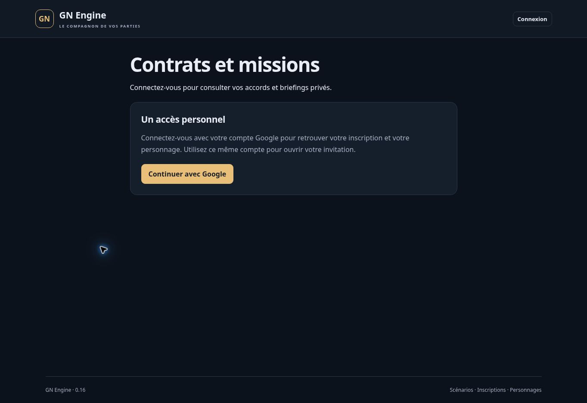

# Version 0.16 — contrats de missions attribuées

20 octobre 2026. Extension partielle de ANN-01/03/04/05/06 et CTR-01/02 du cahier V1 (`docs/source/cahier-des-charges-v1.txt`, chapitres Petites annonces et Contrats). Le parcours des candidatures personnelles débouche sur un accord, un briefing privé, une preuve et un règlement unique. REC-10 n’est pas déclaré terminé : représentation des bandes et quotas de primes ouvertes restent à développer. Aucun lot complet validé.

## Parcours livré

1. Dans **Petites annonces · organisation**, ouvrir les candidatures d’une mission avec sélection, puis l’échange d’un candidat personnel. **Proposer un contrat** permet de saisir le montant entier dans la monnaie configurée, le financement, la durée en minutes de jeu, les conditions, la preuve attendue, la confidentialité et les conséquences narratives d’inexécution.
2. Le MJ compare les conditions, le titulaire, le financement et le briefing prévu, puis confirme la proposition au nom du commanditaire. La proposition ne réserve ni fonds ni place. Une question seule ou une prime ouverte ne peut pas emprunter ce parcours.
3. Le joueur retrouve le contrat dans **Infos** et **Mes missions et contrats**. Il relit et confirme les mêmes conditions, ou décline la proposition. L’acceptation recontrôle les accès, l’autorisation MJ, la version de l’annonce, les places et les fonds.
4. L’acceptation réserve une place et, pour un compte existant, le montant total. Le briefing réservé de cette version est débloqué ; les notes MJ n’ont jamais été copiées dans le contrat. La candidature devient **Mission attribuée**. Les autres concurrents ne voient pas l’accord, la rémunération négociée ou le briefing.
5. Le titulaire écrit un récit de réalisation, en vérifie le contenu puis le remet au MJ. Ce dépôt ne paie rien. Le MJ relit la preuve et les conséquences financières avant de confirmer un règlement, ou demande un complément avant l’échéance.
6. Le règlement débite le payeur et crédite le portefeuille personnel du titulaire, libère sa réservation et ferme le contrat dans une seule transaction. Les répétitions et validations simultanées ne créent pas un second paiement.

Les listes distinguent les propositions, les missions attribuées et les contrats terminés. Les nouvelles versions du contrat apparaissent dans **Infos**, avec un acquittement de lecture explicite. L’historique conserve propositions, acceptation, récits successifs, décisions et motifs partagés de clôture. Les auteurs techniques et le motif financier initial restent réservés au MJ.

## Conditions, places et temps

Le montant du contrat est saisi explicitement. Aucun tarif n’est déduit automatiquement du texte de l’annonce ou du prix proposé dans un message. Les valeurs utilisées dans les tests sont synthétiques, sans valeur de canon ni d’équilibrage.

Le contrat conserve son titre, sa description, son alias de commanditaire, sa rémunération, ses conditions et son briefing. Une modification, une annulation ou un changement d’audience ultérieur de l’annonce ne réécrit pas un contrat accepté. Une offre encore en attente exige, elle, la version courante de l’annonce et l’audience courante. La nouvelle proposition passe par une clôture et une nouvelle double confirmation ; il n’existe pas encore d’avenant à un contrat actif.

Les offres concurrentes ne promettent pas une place garantie avant acceptation. Le compteur d’attributions est modifié atomiquement avec l’accord : deux candidats ne peuvent prendre ensemble la dernière place. Une annonce complète devient **Pourvue**. Une mission payée continue à consommer sa place ; une annulation ou expiration d’un contrat accepté libère la place. Le nombre de places ne peut descendre sous les attributions conservées et leur mode ne peut être changé.

La durée du contrat est un entier entre 1 et 10 080 minutes de jeu, choisi par le MJ. Elle commence à l’acceptation et utilise l’horloge de session : une pause la fige. L’ouverture et l’échéance de réponse de l’annonce gardent le temps réel de la 0.15. Les deux délais sont donc affichés distinctement.

À l’échéance du contrat, le dépôt d’une nouvelle preuve est bloqué. Une preuve déposée à temps reste à examiner et peut être payée ensuite ; elle n’est pas expirée automatiquement. Le MJ peut demander un complément uniquement si le délai permet encore un nouveau dépôt et si la session n’est pas terminée.

**L’expiration financière est une action MJ explicite.** L’écran indique « Échéance atteinte » ; les fonds restent réservés jusqu’à confirmation de l’expiration ou de l’annulation. Aucun traitement planifié ni restitution automatique au simple passage du temps n’est revendiqué. Le MJ voit le montant à libérer et saisit une explication visible au titulaire. Une clôture répétée ne libère pas deux fois les mêmes fonds.

## Financement et journaux

Deux modes sont disponibles :

- **Compte de session** : le MJ autorise le financement depuis un portefeuille personnel actif ou une caisse de groupe. Le montant est réservé à l’acceptation, sans débit définitif. Les paiements ordinaires, achats et corrections utilisent déjà le solde disponible et ne peuvent consommer cette réservation. Après validation, le solde total et le réservé diminuent du montant ; le titulaire reçoit le même montant. Aucun crédit n’est créé.
- **Financement extérieur MJ** : aucune réserve fictive n’est annoncée dans un compte existant. Le règlement crée explicitement les crédits et l’écriture `GM_CONTRACT_PAY` les comptabilise comme création monétaire.

Le compte financeur est choisi et autorisé par le MJ, pas par le candidat. Ce parcours d’intervention organisateur n’accorde aucun droit de dépense aux membres d’un groupe. Il ne sollicite pas une seconde signature du joueur propriétaire du compte financeur. Le candidat voit le commanditaire de fiction et le mode de financement, sans identifiant de compte payeur, solde ou nom d’un groupe secret.

Le compte bénéficiaire est le portefeuille personnel du titulaire. Un paiement depuis ce même compte est refusé. Avant acceptation, une réattribution du personnage payeur invalide l’autorisation en attente. Après acceptation, les fonds engagés restent attachés au contrat ; leur remboursement ou règlement se fait par la procédure MJ.

Réservation, libération et paiement utilisent le journal économique existant, avec référence du contrat et de l’annonce, valeurs avant/après, auteur et motif. Les historiques de portefeuille affichent aussi l’évolution du réservé. Désactiver l’économie bloque une nouvelle acceptation ou un règlement, mais permet au MJ d’annuler le contrat et de libérer sa réservation.

## Confidentialité et accès

Chaque contrat est lié au compte authentifié, au personnage et à sa version d’identité d’accès. Révocation, réactivation, changement de nom ou réattribution ne ressuscitent pas l’ancien consentement. Le successeur du personnage ne lit ni le contrat ni son briefing et ne peut recevoir son règlement. Le MJ garde l’historique et peut restituer les fonds en clôturant ce contrat.

Avant acceptation, les droits de l’organisateur ayant autorisé la proposition sont recontrôlés. Les commandes MJ sont réservées au propriétaire et aux MJ de cette session ; le rôle Accueil et les joueurs en sont exclus. Les droits sont vérifiés avant les résultats idempotents concernés. Les identités fournies dans le JSON ne remplacent jamais l’identité du jeton Google vérifié.

Après acceptation, le contrat constitue un accès privé distinct de l’audience courante de l’annonce, pour son titulaire initial toujours actif. Cela permet de conserver l’accord et son briefing lorsque l’organisation retire l’annonce ou en change le public. Aucun accès n’est transféré au successeur d’un personnage.

L’acceptation et le dépôt de preuve exigent **En jeu** et la permission de publication hors combat. Lecture et acquittement restent possibles en briefing, pause ou fin de partie. Le MJ peut examiner une preuve déjà déposée, payer ou clore un contrat pendant la pause ou après la fin. L’archivage est refusé tant qu’une proposition ou un contrat actif/à examiner subsiste ; une session archivée ferme les accès privés de ce module.

## Vérifications

- `npm test` : **333 tests réussis**, sans échec, annulation ou test ignoré.
- 29 nouveaux parcours métier partagés avec Firestore : consentement, confidentialité, places concurrentes, fonds disponibles, compte personnel/collectif, financement extérieur, preuve, double paiement, horloge, restitution, révocation, changement de financeur, droits, lecture, archivage et panne avant commit.
- 5 nouveaux tests d’interface : séparation propositions/missions/historique, saisie explicite, confirmation, briefing, preuve, clôture et encodage HTML. Le test existant du fil d’annonce vérifie aussi l’accès à la proposition de contrat.
- Un nouveau parcours HTTP avec Auth et Firestore émulés couvre proposition, briefing verrouillé puis ouvert, réservation, preuve, validation MJ, règlement unique et révocation prioritaire.
- Exécution locale complète des intégrations : **282 tests**, dont **281 réussis** et un contrôle de confidentialité initialement trop large (environ 351 secondes, Java 21). Le test cherchait la chaîne « 53 » dans tout le JSON, y compris les identifiants aléatoires. Le faux positif a été reproduit dans un identifiant de personnage ; le montant de son contrat était bien 37. Le contrôle vérifie maintenant les champs de rémunération et l’absence des identifiants/données du concurrent.
- Ce parcours corrigé a été relancé isolément sur Firestore : **1 test réussi**, sans échec (environ 3 secondes). Les **282 parcours d’intégration distincts** ont donc été validés localement ; le réessai ne s’ajoute pas au total. Le code applicatif n’a pas été modifié pour corriger cette assertion.
- `npm test` a ensuite été relancé intégralement : **333/333 réussis**. Total des parcours distincts : **333 + 282 = 615**.
- Le job GitHub `118388669487`, commit source `46b6cafd03cd079c7df58c93d8150257658dcfdf`, confirme **333 + 282 = 615 tests réussis en une exécution complète**, sans échec, annulation ou test ignoré. Node 22.23.3 et Java 21 ; compilation terminée le 20 octobre 2026 à **00:41:11 UTC**, tests métier/interface à **00:41:17 UTC**, intégrations à **00:47:09 UTC** (environ 339 secondes). Résultats lus dans le journal terminé. Les 23 fichiers modifiés ou nouveaux du commit source ont aussi été comparés par empreinte Git aux fichiers locaux.
- Données synthétiques exclusivement dans `demo-gn-engine`. Aucune donnée de test créée en production.

## Limites et recette restante

Cette version couvre les candidats personnels aux missions avec sélection, sans acompte, garantie, rémunération en objets, paiement fractionné ou en plusieurs monnaies. Pas de représentation de bande, de représentant joueur du commanditaire, d’avenant, de signature du propriétaire joueur du compte payeur, de pénalité automatique, de remboursement après paiement ou de litige formalisé.

Les primes ouvertes et leur quota de résultats récompensés restent à développer. Contrats généraux de prêt, location, transport mécanique ou livraison d’objets ne sont pas livrés ici. Une preuve textuelle est un récit à arbitrer, pas une vérification automatique de présence, de capture ou de remise d’objet.

L’expiration et la clôture demandent une action MJ. Les annonces et contrats ne sont pas encore paginés ; le détail affiche les 30 derniers événements, tous restent conservés. Actualisation manuelle, aucun courriel/push, aucune file de réessais hors ligne persistante. Charge 60/120, coûts de lecture, comptes Google réels distincts, téléphones et réseau terrain restent à mesurer.

## Publication

Version **0.16.0 publiée** le 20 octobre 2026 sur [GN Engine](https://gn-engine.web.app/), à partir du commit source [`46b6cafd03cd079c7df58c93d8150257658dcfdf`](https://github.com/gkerckhofs-a11y/gn-engine/commit/46b6cafd03cd079c7df58c93d8150257658dcfdf).

- [Pipeline de déploiement 39349066781](https://github.com/gkerckhofs-a11y/gn-engine/actions/runs/39349066781) terminé avec succès : vérification `118388669487` (615 tests), puis déploiement `118390719313`.
- Fonction HTTP `api` active à **00:49:02 UTC**, publication Hosting terminée à **00:49:11 UTC**. Le contrôle final à **00:49:28 UTC** confirme HTTP 200, manifeste **0.16.0** et réponses **401 / LOGIN_REQUIRED** pour les **98 commandes privées distinctes**.
- [Pipeline de vérification indépendant 39349066801](https://github.com/gkerckhofs-a11y/gn-engine/actions/runs/39349066801), job `118388669682`, également terminé avec succès.
- Le navigateur affiche **GN Engine · 0.16** sur l’accueil. L’ouverture anonyme de `#/contracts/verification` affiche **Contrats et missions**, demande une connexion et n’expose aucun accord ou briefing privé. La capture ci-dessous prouve cette fermeture d’accès et la version affichée ; elle ne constitue pas une recette authentifiée du parcours de contrat.

Le commit de preuves ne modifie pas le code applicatif ni la demande de déploiement. La recette avec plusieurs comptes réels, sur téléphone et réseau terrain, reste ouverte.
