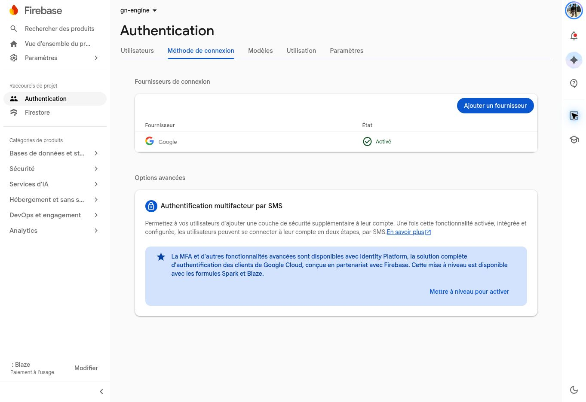
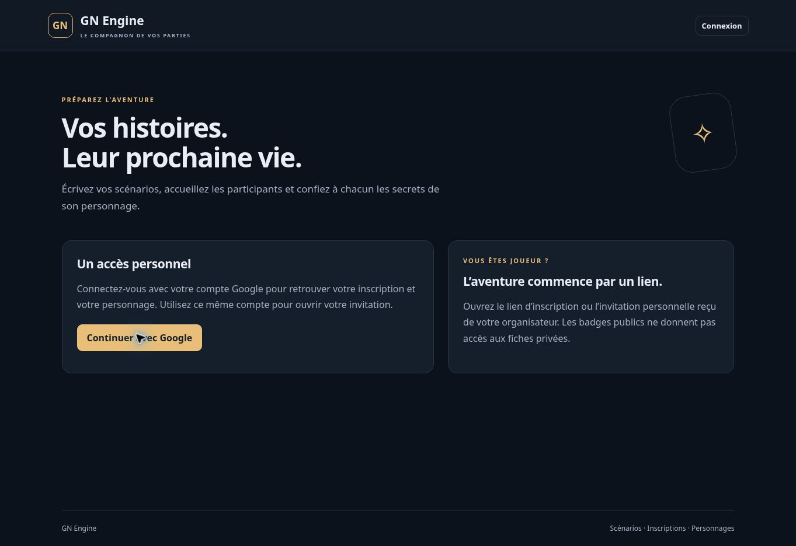

# Validation du premier parcours — 19 octobre 2026

## Résultats observés

- Compilation esbuild réussie ; le bundle public n’inclut ni canon, ni archives, ni code serveur.
- `npm test` : 28/28 tests passent (Node 24.19 local ; également vérifié sous Node 22 sur GitHub Actions).
- `npm run test:emulator` : 14/14 tests passent avec Firebase CLI 15.34, Auth Emulator, Firestore Emulator 1.22, Java Temurin 21.
- Le véritable gestionnaire HTTP exporté pour Cloud Functions est monté dans Express pour les essais HTTP. L’émulateur Functions complet ne pouvait pas ouvrir son socket Unix local (EPERM) ; il n’est pas présenté comme validé localement.
- Firestore créé en Belgique et fournisseur Google activé, vérifiés dans la console.
- Autorisation GitHub/Google validée par Workload Identity Federation, après exécution du script par le propriétaire.
- Fonction `api` (Node 22, `europe-west1`, compte runtime dédié), Firebase Hosting, règles et index publiés le 19 octobre 2026 : https://gn-engine.web.app/.
- Contrôles de production : accueil HTTP 200 ; lecture `dashboard` anonyme refusée en HTTP 401 avec `LOGIN_REQUIRED`, via Hosting et directement via les adresses publiques du serveur.
- Accueil public vérifié visuellement dans Chrome ; le bouton Google ouvre la page officielle de sélection de compte pour cette application. Aucune connexion complète ni création de données de jeu en production n’a été effectuée pendant cette vérification.
- Le premier envoi omettait les manifestes racine à cause du filtre `*`. Filtre corrigé et archive réelle créée avec le SDK Google contrôlée : exactement neuf fichiers serveur, dont les deux manifestes et le point d’entrée.
- Le contrôle immédiatement après la première publication avait reçu HTTP 404, puis HTTP 401 après propagation du routage. Le contrôle attend désormais les erreurs temporaires de disponibilité avec une limite de douze tentatives ; il n’accepte jamais HTTP 200 pour la lecture privée anonyme.

GitHub Actions a réussi compilation, 28 tests métier et 14 intégrations sur le commit `5a44f87f0a27e7846d33a17d1b12cadc5eda4822` : https://github.com/gkerckhofs-a11y/gn-engine/actions/runs/39250124412

Publication complète réussie sur le commit `b9bb80fbd8c266f7da70e72da6107c2ca725f020` : [workflow GitHub du 19 octobre 2026](https://github.com/gkerckhofs-a11y/gn-engine/actions/runs/39254991010). Les deux jobs `verify` et `deploy` ont réussi, y compris compilation, 42 tests, publication de la fonction/Hosting/règles/index et contrôle HTTP final.

## Cas testés sur Firestore

1. Dernière place concurrente : une acceptation, une attente, compte de places cohérent.
2. Inscription, attribution, invitation, activation, briefing, lecture privée et badge public sans fuite.
3. Invitation nominative, stockage de l’empreinte seulement, consommation unique même en concurrence.
4. Expiration réelle et invalidation après renouvellement.
5. Réattribution retirant immédiatement l’accès de l’ancien titulaire.
6. Téléphone perdu : ancienne date d’authentification refusée même après réactivation sur un autre appareil.
7. Modèle modifiable sans effet sur la version figée ni la session ; révision périmée refusée.
8. Brouillon inaccessible au joueur et au badge, même avec attribution active.
9. Réouverture d’accueil sans redémarrage du jeu en pause.
10. Annulation libérant place et attribution sans supprimer le personnage.
11. Identités non vérifiées, fausse déclaration de rôle, compte ordinaire et session étrangère refusés.
12. Règles Firestore refusant les lectures et écritures directes non authentifiées.
13. Publication dans une session sans modifier le modèle ni perdre le titulaire, et confirmation de lecture.
14. HTTP/Auth : jeton Google vérifié, jeton falsifié, compte ordinaire, usurpation d’en-tête Sites et création autorisée par le propriétaire.

Les comptes et données sont synthétiques, dans `demo-gn-engine`. Aucun vrai compte Google de joueur n’a été créé ou utilisé. REC-01 est couvert au niveau service, pas encore recetté dans plusieurs navigateurs en production.

## Limites à lever après publication

- Connexion Google réelle, fenêtres mobiles, QR, invitations et affichage responsive.
- Recette avec comptes distincts et délais réseau réels.
- Charge 60/120, taille des versions, coûts, restauration et secours.
- Rôles délégués, groupes et autres lots ; le noyau de paiement n’est pas exposé comme fonctionnalité de cette version.
- Les informations déjà vues/copées ne peuvent pas être effacées à distance. La révocation bloque les nouvelles lectures serveur ; pas de cache privé hors ligne.
- Notification courriel, effacement/anonymisation et application automatique de la durée de conservation à réaliser. Une notice publique doit être renseignée à la création de session.

## Contrôles d’accès

Invitations aléatoires 256 bits, fragment du lien puis corps POST à la consommation, SHA-256 uniquement en base. Lien attaché à l’UID inscrit, à la session, au personnage, à la version d’accès et à une échéance. Ni le journal ni les opérations ne stockent les jetons en clair.

Le serveur vérifie les jetons Firebase avec révocation, les droits et les ressources. Les réponses utilisent des listes blanches. Les transactions protègent places et attributions. Les SDK Admin contournant les règles client, chaque commande assure ses propres contrôles.

Dépendances verrouillées. Le service ne journalise pas les corps de requête et retourne `Cache-Control: private, no-store`.
