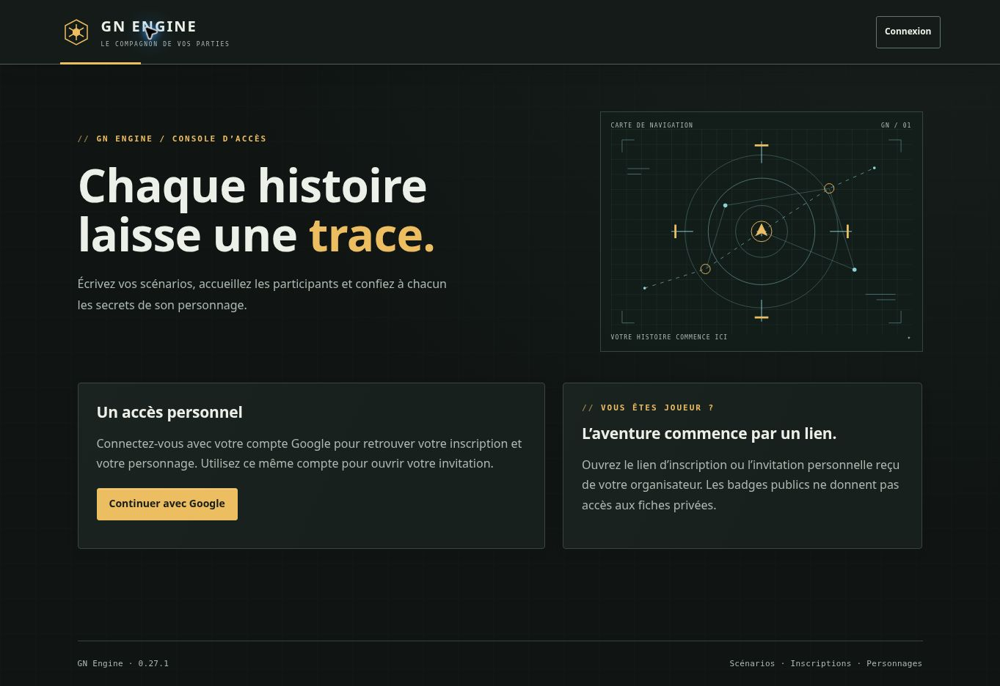

# Validation GN Engine 0.27.1 — habillage galactique

20 octobre 2026. Auteur : Codex. Demande : une skin évoquant Star Wars sur l’ensemble de l’application.

## Livré dans le code

Thème commun aux interfaces joueur et organisateur : surfaces sombres, accents ambrés et cyan, pictogrammes vectoriels, accueil avec carte de navigation décorative, formulaires, imports, médiathèque et dialogues harmonisés. Aucun changement de règles, de données ou de droits. [Description et limites](THEME-GALACTIQUE.md).

## Vérifications locales

523 tests applicatifs réussis, aucun échec ni test ignoré ; compilation réussie. Analyse des styles par esbuild sans avertissement. Contrastes des principales couleurs de texte supérieurs à 8:1 (ce contrôle ciblé ne vaut pas audit complet d’accessibilité).

Le navigateur distant ne peut pas ouvrir la prévisualisation locale. Aucune validation visuelle mobile ou des pages privées n’est revendiquée pour cette livraison. La fixture `test/ui/galactic-preview.mjs` permet une recette séparée sans compte ni données réelles.

## Publication

Source : `26628014c03b32345d090c0d356a53b3fbcdc754`. Demande de publication : `110dc87a09d39ca11792a6977b54d61733b82f25`.

[Exécution GitHub Actions 39464302401](https://github.com/gkerckhofs-a11y/gn-engine/actions/runs/39464302401). Job de vérification : 118771541214, terminé avec succès. Job de déploiement : 118777227518.

| Vérification | Résultat du 20 octobre 2026, heure UTC |
| --- | --- |
| Tests applicatifs | 523 réussis, 0 échec, 0 ignoré ; terminés à 17:14:53 |
| Intégrations Firebase | 421 réussies, 0 échec, 0 ignorée ; terminées à 17:25:21 |

Total avant publication : **944 tests réussis** (523 + 421).

Firebase Hosting a terminé la publication à 17:31:11 UTC. L’accueil 0.27.1 et son nouvel habillage ont été confirmés dans le navigateur.

Le job de déploiement est néanmoins marqué en échec : son dernier contrôle cherchait un espace littéral après le numéro de version. Le nouvel élément `` ferme ce numéro sans espace, ce qui faisait rejeter la bonne version. Le contrôle extrait désormais le numéro dans le pied de page et le compare exactement ; une mauvaise version, un suffixe supplémentaire ou un numéro situé ailleurs restent refusés. Les sept tests ciblés de publication passent, dont la régression ajoutée pour cet habillage.

Le contrôle du site publié a été relancé depuis l’environnement de travail : version HTML exacte, manifeste, quatre masters identiques et totalité des commandes privées anonymes refusées en HTTP 401 / LOGIN_REQUIRED. Pour terminer les contrôles réseau, les mêmes assertions ont été exécutées par groupes de huit requêtes indépendantes ; aucun accès authentifié ni écriture métier n’a été utilisé. Résultat final confirmé le 20/10/2026 à 17:40:07 UTC. La chaîne de publication initiale conserve son statut d’échec du contrôle HTML ; la nouvelle vérification est distincte.

