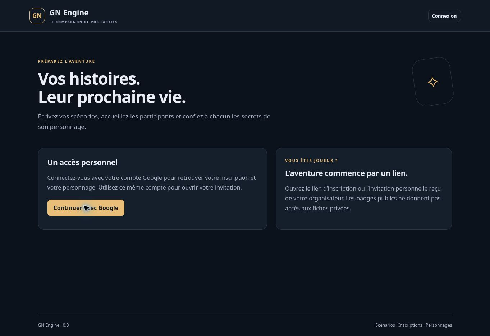

# Version 0.3 — équipe et fiches narratives

19 octobre 2026. Extension du lot A et première partie des relations du lot B. Cette version ne clôt pas un lot entier ni les 132 exigences.

## Fonctionnalités

- Le propriétaire délègue un rôle MJ ou Accueil à une adresse de compte Google vérifiée, pour une seule session. Aucun message n'est envoyé. Seul le propriétaire peut ajouter, modifier ou révoquer ces délégations.
- Accueil : inscriptions et réponses privées, ouverture/fermeture des inscriptions, attributions, invitations et révocations des accès joueurs. Le serveur n'envoie ni histoire, secrets, relations, objectifs, notes MJ, ni historique de personnages à ce rôle.
- MJ : mêmes droits, plus édition des fiches, aperçu joueur, historique et pilotage des états de jeu. Ce rôle ne permet pas de modifier le scénario source ni de gérer l'équipe.
- Relations orientées : titre et texte destinés au personnage source, publication individuelle et notes MJ. La référence technique facultative vers un autre personnage reste réservée aux MJ ; le destinataire ne reçoit aucune relation en retour. Une référence hors scénario/session est refusée.
- Objectifs narratifs : titre, texte, publication individuelle et notes MJ. L'interface n'implémente pas encore les conditions, récompenses ou résolution automatique de missions. Les éventuelles étapes déjà présentes sont conservées ; leur éditeur reste à développer.
- Historique des projections publiées, avec auteur, date, motif et révision. Une fiche publiée dans un scénario ou en préparation n'est pas une preuve de lecture : la session doit aussi avoir ouvert son briefing. L'ancien texte d'une fiche 0.2 est capturé à sa première modification, avec une date de capture explicitement distincte d'une date de publication inconnue.
- Modification d'une fiche de session avec motif obligatoire, conservation de l'attribution et des PV existants, et nouvelle confirmation de lecture de la révision actuelle.
- Recherche locale dans les inscriptions et identités autorisées. Les secrets ne servent pas d'index de recherche pour l'accueil.

## Vérifications réalisées

- `npm run build` : compilation réussie.
- `npm test` : 37 tests métier réussis.
- `PATH=/tmp/gn-java21/bin:$PATH npm run test:emulator` : 24 tests d'intégration réussis, avec Firestore et Auth dans `demo-gn-engine`.
- La suite partagée vérifie ces neuf cas supplémentaires en mémoire et sur Firestore : projection accueil sans secrets ; MJ limité à sa session ; diminution/révocation des droits et réessai mémorisé ; délégations concurrentes et journal ; relations orientées/objectifs filtrés ; historique/lecture/PV ; références invalides et absence d'écriture ; édition simultanée par deux MJ ; identité Google vérifiée obligatoire.
- Un essai HTTP/Auth supplémentaire vérifie l'effet réel d'une délégation, le rejet de la fausse déclaration de rôle, l'absence des secrets dans la réponse et la révocation immédiate.
- Les tests créent exclusivement des comptes synthétiques dans Auth Emulator. Aucune délégation ni donnée de jeu de test n'a été créée en production par cette livraison.

## Publication vérifiée

- Source déployée : `782c7fb814dfbed5e4100e4dbdc0ad01ac39a06c`.
- [Workflow Firebase du 19 octobre 2026](https://github.com/gkerckhofs-a11y/gn-engine/actions/runs/39257789559) : jobs `verify` et `deploy` réussis. Compilation, 37 tests métier et 24 intégrations, fonction en Belgique, Hosting, règles et index publiés.
- Le contrôle final confirme `version.json` en `0.3.0`, accueil HTTP 200 et API privée refusant la lecture anonyme en HTTP 401 (`LOGIN_REQUIRED`).
- Accueil réel rechargé et vérifié dans Chrome sur https://gn-engine.web.app/ ; pied de page « GN Engine · 0.3 ». Aucune connexion Google complète ni manipulation des formulaires privés en production n'est déclarée validée.

## Modèle et compatibilité

`sessionStaff/{sha256(sessionId:email_normalisé)}` contient session, propriétaire, adresse, rôle, activation et date/auteur de modification. Les droits courants sont relus dans la transaction, avant de rendre aussi un résultat idempotent. Les deux requêtes de découverte utilisent les index simples Firestore existants ; aucun index composé ajouté.

Les fiches ajoutent `relations`, `contentRevision` et `historyStarted`. Les objectifs existants sont préservés lorsqu'une commande ne les fournit pas. Chaque historique se trouve sous `characters/{id}/history/{operationId}` dans le scénario ou la session. Il contient uniquement la projection publiée et les métadonnées MJ, pas un second exemplaire des notes MJ. Les versions de scénario et copies de session antérieures restent utilisables sans migration destructrice.

Les anciennes confirmations de lecture ne portent pas de révision : l'interface demande une nouvelle confirmation au lieu d'affirmer que le joueur a lu la fiche actuelle. Le journal de modification relie auteur, motif, personnage et révisions avant/après ; les corrections générales d'états de jeu restent à intégrer.

## Limites de recette

- Interface compilée ; recette complète des nouveaux formulaires dans des navigateurs connectés avec plusieurs vrais comptes Google encore nécessaire.
- Aucune mesure de charge 60/120 ni validation des tailles maximales de transactions et historiques.
- L'historique prouve une publication, pas que le joueur a vu l'écran. La confirmation indique la révision déclarée lue.
- Une révocation bloque les nouvelles lectures serveur ; elle ne peut retirer les informations déjà reçues ou copiées.
- Les groupes, permissions par ressource, connaissances/documentation, médias, missions mécaniques, compétences, inventaires, économie et vaisseaux restent à développer. Les rôles MJ/Accueil sont des profils fixes ; il n'y a pas encore de rôle à permissions personnalisées.
