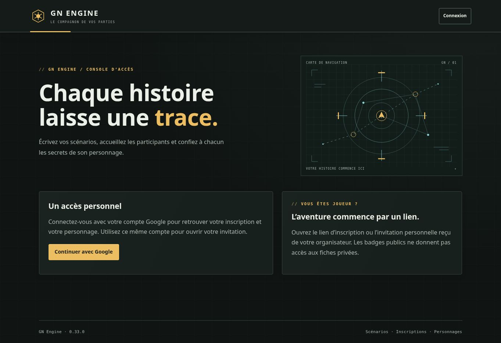

# Validation de la version 0.33.0

État : version publiée et vérifiée le 21 octobre 2026. Compilation, 605 tests applicatifs et 486 tests Firebase réussis.

## Périmètre vérifié

- Suspension des ventes et paiements à prix fixe ou indexé, ventes privées incluses, même sans cours configuré.
- Confirmation périmée refusée sans débit, levée de suspension, annulation et retrait d’un achat déjà payé.
- Variations de carburant et durée, cumul et arrondi supérieur, suspension d’une route, coût unique et voyage figé au départ.
- Sabotage et réparation réels déclenchant ou retirant cours, suspension commerciale et perturbations de route. Pause et expiration de panne.
- Projections publiques sans référence d’installation ni motif MJ.
- Import CAMPAGNE puis SESSION, réimport inchangé, version publiée, export/import autonome et anciennes archives compatibles.
- Refus atomique des références absentes, effets incompatibles et pourcentages invalides.
- Conservation des données, styles, dimensions, validations, volets et objets des onglets préexistants des quatre XLSX, hors Guide et Dictionnaire mis à jour.
- Écrans de réglage et confirmation : champs séparés selon la cible, textes échappés, effets publics et indisponibilités explicites.

Quatre nouveaux scénarios sont partagés entre MemoryStore et Firestore. Le scénario existant de sabotage est étendu aux conséquences commerciales et de transport. Deux contrôles applicatifs supplémentaires couvrent les bornes numériques et les formulaires.

## Vérification des masters

Édition des quatre fichiers existants avec Artifact Tool. Ajout de Cours et EvenementsEco, actualisation du Guide et du Dictionnaire. Recalcul, réimport des fichiers livrés, import réel des deux exemples par le moteur et contrôle des rendus des vues modifiées. Aucun tarif de production ni dotation supplémentaire sur un personnage existant.

## Limites

Les tests de règles et transactions ne remplacent pas la recette privée sur téléphones ni un essai à 60 joueurs. Aucun compte, événement ou stock réel de production n’a été créé pour la validation. La suspension du commerce laisse possibles les dons et virements séparés, conformément au périmètre décrit dans le [guide](EVENEMENTS-ECONOMIQUES.md).

## Traçabilité de publication

- Commit source : `ea78b90b4e471bac00ea68ec78e9bd6e8a32a4dc`.
- Demande de publication : `b021683c87f68ac44c25c83d059e1e69fcfa17ce`.
- [Chaîne GitHub Actions réussie](https://github.com/gkerckhofs-a11y/gn-engine/actions/runs/39595995754), validation `119208320136`, publication `119215710808`.
- Compilation terminée à 13:59:11, 605 tests applicatifs à 13:59:19, 486 tests Firebase à 14:15:42. Horaires du 21 octobre 2026, heure de Bruxelles.
- Firebase Hosting publié à 14:17:40.
- Quatre téléchargements XLSX vérifiés à 14:17:41, identiques octet par octet aux fichiers validés du dépôt.
- Version 0.33.0 accessible et refus des accès anonymes aux commandes privées vérifiés à 14:18:18.
- Accueil rechargé dans Chrome : pied de page « GN Engine · 0.33.0 » visible à l’adresse `https://gn-engine.web.app/#/`.
- La capture atteste la version publique ; elle ne constitue pas une recette visuelle des écrans privés.

