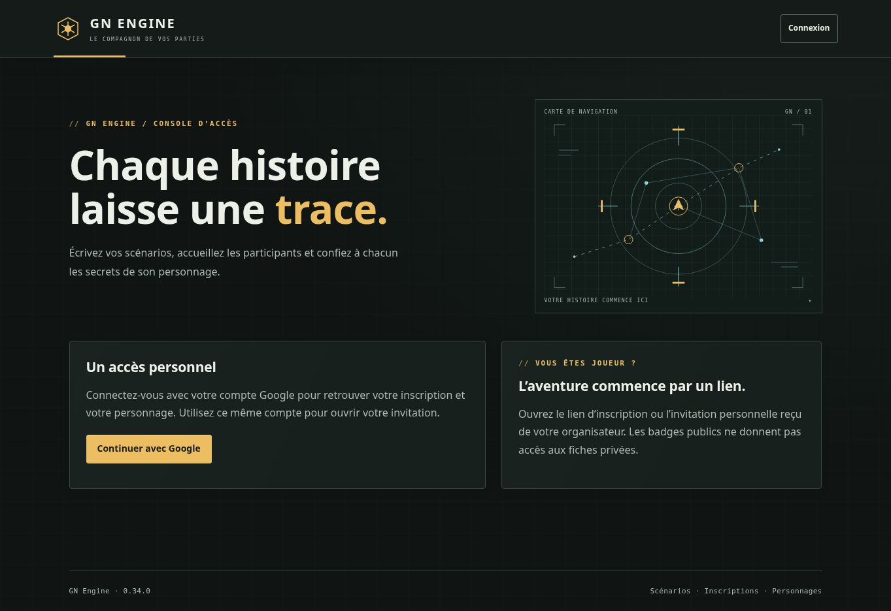

# Validation de la version 0.34.0

État : version publiée et vérifiée le 21 octobre 2026. Compilation, 625 tests applicatifs et 502 tests Firebase réussis sur GitHub.

## Périmètre vérifié

Seize scénarios de négociation partagés entre MemoryStore et Firestore, complétés par quatre contrôles d’interface :

- Offre, contre-offre à tour de rôle, acceptation sans débit, confirmation du prix et retrait physique sans second paiement.
- Achat au prix négocié avec quantité et montant imposés par le serveur ; impossibilité d’utiliser l’accord d’un autre acheteur ou d’une autre annonce.
- Messages et prix négociés exclus du marché public ; montant payé par un concurrent absent de l’ancien échange de l’autre acheteur.
- Révisions, rejeu idempotent et refus des confirmations modifiées ou périmées.
- Contre-offre concurrente à une acceptation, achat immédiat concurrent à un paiement négocié, clôture concurrente à un paiement. Une seule issue comptable et une seule propriété.
- Validité en temps réel, plafond de l’annonce, absence de prolongation par contre-offre, nouvelle proposition après clôture ou expiration.
- Prix convenu fixe malgré changement ou fermeture du cours ; embargo prioritaire, puis nouvelle confirmation à sa levée.
- Caisse autorisée sans droit de lecture, solde masqué, insuffisance de fonds et révocation du droit de dépense avant rejeu.
- Révocation/réactivation des identités, accès anonyme et tiers refusés, phase de jeu, santé, économie et scellement de campagne.
- Panne avant commit : absence d’offre partielle, de débit partiel ou de changement partiel de propriétaire.
- Formulaires, historique, messages échappés et identifiant d’accord conservé jusqu’au paiement.

Les suites de marché et de ventes existantes restent exécutées. Les quatre masters ne sont pas modifiés par ce lot.

## Limites

L’accord de prix n’est pas exclusif et n’immobilise pas de crédits. L’acheteur devient propriétaire même si une caisse paie. Les écrans l’indiquent avant les confirmations ; voir le [guide](NEGOCIATION-COMMERCIALE.md).

La recette privée sur téléphones et un essai simultané à 60 joueurs restent à effectuer. Aucun compte joueur ni stock de production n’est créé pour les tests. La capture publique de version ne vaut pas validation visuelle des écrans privés.

## Traçabilité

- Commit source : `0c3531dfac256cd3265fa8f7097d983249645128`.
- Arbre source : `50c607d634e64b5d28311dbeb0ac1cf679a1e171`.
- Demande de publication : `cd35bfaa3c2391bddc6b0a516999ff3ddd6f1a16`.
- Arbre de publication : `e093049bc3ae1c654c2a076dc988125770b678ac`.
- [Chaîne GitHub Actions](https://github.com/gkerckhofs-a11y/gn-engine/actions/runs/39615021206) : `39615021206` ; validation : `119273631307` ; publication : `119280930808`. Les étapes de validation, de publication et de vérification du site ont toutes réussi.
- Compilation terminée à 16:14:11, tests applicatifs à 16:14:22 et tests Firebase à 16:28:26 le 21 octobre 2026, heure de Bruxelles. Aucune erreur et aucun test ignoré.
- Firebase Hosting publié à 16:32:50, le 21 octobre 2026, heure de Bruxelles.
- Quatre masters téléchargés et comparés octet par octet à 16:32:51, identiques aux fichiers validés du dépôt.
- Version 0.34.0 accessible et accès anonymes refusés aux commandes privées, dont les six commandes de négociation, à 16:33:30.
- Accueil rechargé dans Chrome : pied de page « GN Engine · 0.34.0 » visible à l’adresse `https://gn-engine.web.app/#/`.
- La capture atteste la version publique ; elle ne constitue pas une recette visuelle des écrans privés.

