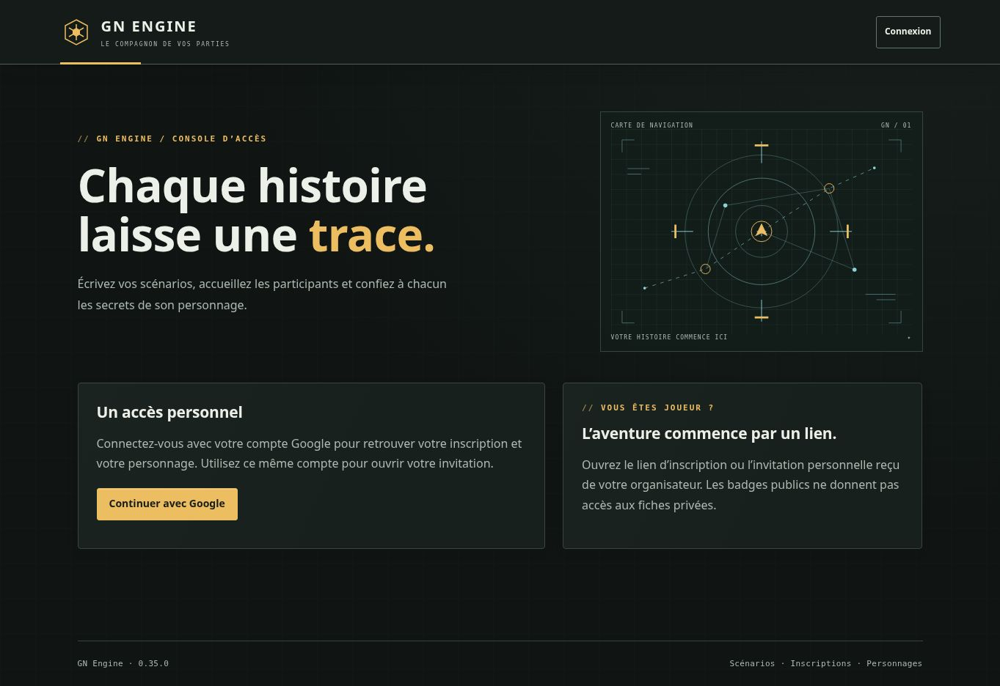

# Validation de la version 0.35.0

État : version publiée et vérifiée le 21 octobre 2026. Compilation, 641 tests applicatifs et 515 tests Firebase réussis sur GitHub.

## Périmètre vérifié

Treize scénarios de douanes partagés entre MemoryStore et Firestore, complétés par trois contrôles d’interface :

- Configuration explicite, aperçu sans effet, révisions, réessai unique, données invalides et accès régie protégés.
- Montants fixes et par unité, cumul douane/corruption, filtrage par objet et sens, mouvements sac–entrepôt gratuits.
- Absence de débit à la réservation ; paiement des différents bénéficiaires et retrait monétaire à la réception, conservation des quantités et écritures équilibrées.
- Tarif conservé malgré modification ou désactivation ; ancien chargement sans tarif restant gratuit ; aperçu périmé refusé.
- Choix d’un portefeuille autorisé, confirmation monétaire et réception physique obligatoires ; montants imposés par le serveur.
- Fonds réservés indisponibles, dépassement du solde d’un bénéficiaire et modification des comptes entre aperçu et règlement : aucun effet partiel.
- Réceptions concurrentes, réception concurrente à une annulation et réessai du gagnant : une seule issue comptable et logistique.
- Plusieurs lignes vers le même bénéficiaire et bénéficiaire identique au payeur : compensation nette et conservation monétaire.
- Caisse autorisée en dépense seule : soldes masqués, alias public et révocation des permissions vérifiée avant réessai.
- Pause, économie désactivée, hors combat et maintien de l’annulation gratuite.
- Clôture de campagne bloquée par les chargements ouverts ; reprise des tarifs, identifiants et soldes sans rejouer les paiements.
- Panne simulée après préparation des écritures : ni débit, ni crédit, ni reçu, ni déplacement partiel.
- Écrans : textes échappés, sélection des comptes autorisés, préparation du paiement, case de réception obligatoire, absence de montant ou d’activation implicite.

Les suites existantes de cargaison, marché, portefeuilles, logistique et campagne restent exécutées. Les quatre masters ne sont pas modifiés par ce lot.

## Limites

Les tarifs s’appliquent aux mouvements de cargaison impliquant une soute. Ils se configurent en régie de session et suivent les campagnes ; leur création par master et archive de scénario reste à ajouter. Aucun contrôle douanier avec détection, exemption ou pot-de-vin négocié n’est simulé. Voir le [guide](DOUANES-CORRUPTION.md).

La recette privée sur téléphones et un essai simultané à 60 joueurs restent à effectuer. Aucun compte joueur, stock ou tarif de production n’est créé pour les tests. Une capture publique de version ne vaut pas validation visuelle des écrans privés.

## Traçabilité

- Commit source : `30b7d302c8b7cf18c42e4540ee266262024f2db1`.
- Arbre source : `5fe8e85fda8706ac69e14529a2559a9303c66c64`.
- Demande de publication : `2b2b93a5498d378aaecd7a05f83f6bda8639d4b6`.
- Arbre de publication : `a9a5b37f4037b615ed50d5bf243a475b2f77ef8b`.
- [Chaîne GitHub Actions](https://github.com/gkerckhofs-a11y/gn-engine/actions/runs/39626547891) : `39626547891` ; job de validation : `119313181866` ; publication : `119321989437`. La chaîne et ses deux jobs sont terminés avec succès.

- Compilation terminée à 17:32:29, tests applicatifs à 17:32:44 et tests Firebase à 17:48:48 le 21 octobre 2026, heure de Bruxelles. 1 156 tests réussis, aucun échec, aucune annulation et aucun test ignoré.

- Firebase Hosting publié à 17:50:37 le 21 octobre 2026, heure de Bruxelles.
- Quatre masters téléchargés et comparés octet par octet à 17:50:38 : identiques aux fichiers validés du dépôt.
- Version 0.35.0 accessible et accès anonymes refusés aux commandes privées à 17:51:30, dont les trois commandes de régie douanière et la préparation de réception payante.
- Accueil rechargé dans Chrome : pied de page « GN Engine · 0.35.0 » visible à l’adresse `https://gn-engine.web.app/#/`.
- La capture atteste la version publique ; elle ne constitue pas une recette visuelle des écrans privés.

